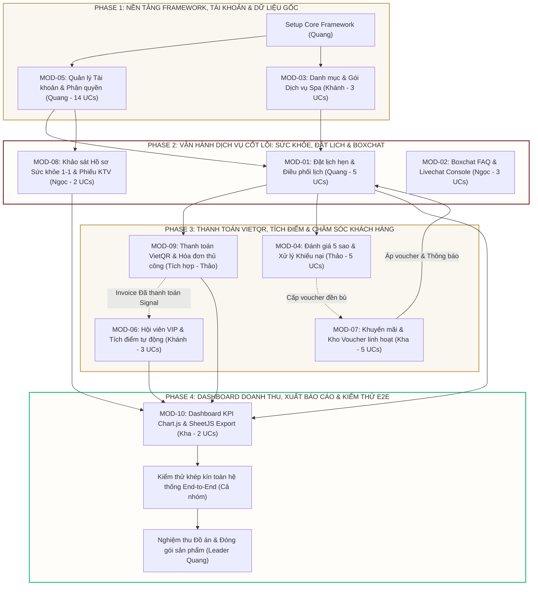

# HỆ THỐNG QUẢN LÝ QUAN HỆ KHÁCH HÀNG & ĐẶT LỊCH DỊCH VỤ SPA (CHAMSPA CRM)

[](https://www.python.org/)
[](https://www.djangoproject.com/)
[](https://getbootstrap.com/)
[](https://www.sqlite.org/)
[](https://vietqr.io/)
[](#-v-chức-năng-chi-tiết-các-module-mod-01-đến-mod-10)

---

## 📌 I. THÔNG TIN CHUNG DỰ ÁN

* **Tên đề tài:** Hệ thống Quản lý Quan hệ Khách hàng & Đặt lịch dịch vụ Spa (**ChamSPA CRM**)
* **Đơn vị đào tạo:** Trường Đại học Kinh tế – Đại học Đà Nẵng (**DUE**) | **Học phần:** Lập trình Web
* **Doanh nghiệp nghiên cứu:** **ChamSpa & Massage Đà Nẵng** (Massage trị liệu Đông y & Thư giãn chuyên sâu)
* **Địa chỉ cơ sở:** 05 Lê Quang Hoà, Hoà Xuân, Cẩm Lệ, TP. Đà Nẵng | **Hotline:** `0987 773 777` | **Giờ mở cửa:** `8:30 – 22:00`
* **Đội ngũ sinh viên thực hiện (5 thành viên) & Phân công phân hệ:**
  1. **Lê Nhật Quang (Leader):** Kiến trúc lõi (`core`), **MOD-01** (`appointment`), **MOD-05** (`accounts`)
  2. **Thảo Ngọc:** **MOD-02** (`chatbox`), **MOD-08** (`health`)
  3. **Minh Khánh:** **MOD-03** (`services`), **MOD-06** (`membership`)
  4. **Thanh Thảo:** **MOD-04** (`feedbacks`), **MOD-09** (Thanh toán VietQR & Hóa đơn — tích hợp trong `appointment`, `membership/signals.py` và `dashboard`)
  5. **Minh Kha:** **MOD-07** (`marketing`), **MOD-10** (`dashboard`)

---

## 🛠️ II. KIẾN TRÚC HỆ THỐNG & CÔNG NGHỆ

### 1. Công nghệ sử dụng (Tech Stack)

1. **Backend & Xử lý nghiệp vụ:** Python (`>= 3.10`, đã kiểm thử trên `3.14.5`) kết hợp **Django 6.1.2** (`requirements.txt` liệt kê `Django>=5.1`, `djangorestframework>=3.14.0`, `Pillow>=10.0.0`, `asgiref>=3.8.0`, `sqlparse>=0.5.0`). Tầng backend hiện tại được chuẩn hóa theo mô hình **Django SSR Views/Forms** kết hợp các **Pure Django JSON APIs (`JsonResponse` + helpers tại `core/ajax.py`)** gọn nhẹ và đồng nhất.
2. **Cơ sở dữ liệu (Database):** **SQLite** (`db.sqlite3`) — toàn bộ **20 model** của hệ thống được định nghĩa tập trung trong [`core/models.py`](core/models.py) và đăng ký quản trị tại [`core/admin.py`](core/admin.py). Ngôn ngữ `vi`, múi giờ `Asia/Ho_Chi_Minh`.
3. **Giao diện & Layout:**
   * **Django Templates** với 4 layout kế thừa theo vai trò (`public_layout.html`, `customer_layout.html`, `staff_layout.html`, `admin_layout.html`) và các sidebar/topbar chuyên biệt trong `templates/components/`.
   * **Bootstrap 5.3.3** & **Bootstrap Icons 1.11.3**, tùy biến bộ màu & typography Cham Spa tập trung tại [`static/css/chamspa.css`](static/css/chamspa.css).
   * **Google Fonts:** `Lora`, `Tinos` (tiêu đề serif) và `Cabin`, `Manrope` (nội dung).
4. **Tương tác động & Thư viện Client (CDN):**
   * **Vanilla JavaScript (Fetch API):** Gọi JSON API bất đồng bộ để lọc dữ liệu, cập nhật trạng thái, chat polling, mở modal và render bảng biểu.
   * **Chart.js:** Vẽ **6 biểu đồ** phân tích doanh thu, dịch vụ, hội viên, trạng thái lịch và hồ sơ sức khỏe trên Dashboard Quản trị.
   * **SheetJS (`xlsx 0.18.5`) & `html2pdf.js 0.10.1`:** Xuất báo cáo Excel (`.xlsx` với 2 sheet `TongQuan_KPI` & `ChiTiet_HoaDon`) và PDF (`.pdf`) trực tiếp tại trình duyệt ở `admin_dashboard.html`.
   * **FullCalendar (`6.1.15`):** Đã nạp sẵn qua CDN trong `templates/base.html` làm nền mở rộng (giao diện đặt lịch & điều phối hiện sử dụng lưới chọn ngày/slot và bảng lọc tối ưu riêng).
   * **VietQR (`img.vietqr.io` / `api.vietqr.io`):** Sinh ảnh mã QR chuyển khoản theo số tiền và nội dung `CHAMSPA <MÃ_LỊCH>` (hiển thị hướng dẫn chuyển khoản; việc xác nhận & đổi trạng thái thanh toán được thực hiện thủ công bằng thao tác bấm nút, **không tích hợp webhook ngân hàng tự động**).
5. **Middleware & Lưu trữ Media:**
   * `core.middleware.ChamSpaErrorFallbackMiddleware` điều hướng trang `404.html` / xử lý lỗi an toàn (bỏ qua các đường dẫn API).
   * Lưu ảnh đại diện (`media/avatars/`) và ảnh minh chứng đánh giá/khiếu nại (`media/feedbacks/YYYYMM/`) bằng `Pillow`.

### 2. Cấu trúc thư mục dự án

```text
CHAMSPA CRM/
├── config/                 # Cấu hình Django (settings.py, urls.py, wsgi.py, asgi.py)
├── core/                   # 20 Models CSDL tập trung, admin.py, ajax.py, middleware.py, views.py
├── accounts/               # MOD-05: Xác thực, hồ sơ cá nhân, quản lý Khách hàng 360 & Nhân viên
├── appointment/            # MOD-01 (+ VietQR MOD-09): Đặt lịch, Digital Pass, dời/hủy, điều phối & thanh toán
├── chatbox/                # MOD-02: Chatbot FAQ, Widget, Staff Livechat Console & Admin Monitor
├── services/               # MOD-03: Danh mục liệu trình, chi tiết dịch vụ & quản trị dịch vụ
├── feedbacks/              # MOD-04: Đánh giá 5 sao, khiếu nại có minh chứng & cấp voucher đền bù
├── membership/             # MOD-06: Thẻ hội viên 4 hạng, tra cứu tại quầy & Signal tích điểm tự động
├── marketing/              # MOD-07: Khuyến mãi, kho Voucher, chuông thông báo & broadcast
├── health/                 # MOD-08: Hồ sơ sức khỏe 1-1, BMI, cảnh báo y tế & phiếu KTV in ấn
├── dashboard/              # MOD-10: Staff Dashboard, Admin Dashboard 6 biểu đồ & Export Excel/PDF
├── payments/               # Thư mục giữ chỗ cũ (nghiệp vụ MOD-09 đã tích hợp vào appointment, membership & dashboard)
├── templates/              # Giao diện HTML phân chia theo layouts/, components/ và từng app
├── static/                 # CSS hợp nhất (chamspa.css) & tài nguyên hình ảnh thương hiệu
├── seed_demo_data.py       # Script reset và khởi tạo dữ liệu mẫu sạch cho toàn bộ 20 bảng
├── requirements.txt        # Danh sách thư viện Python phụ thuộc
├── db.sqlite3              # Cơ sở dữ liệu SQLite demo đi kèm
└── manage.py
```

---

## 🚀 III. HƯỚNG DẪN CÀI ĐẶT & TÀI KHOẢN DEMO

### 1. Cài đặt và chạy trên máy local

```bash
# 1. Tạo và kích hoạt môi trường ảo
python -m venv .venv

# Windows (PowerShell)
.venv\Scripts\Activate.ps1
# macOS / Linux
source .venv/bin/activate

# 2. Cài đặt thư viện phụ thuộc
pip install -r requirements.txt

# 3. Kiểm tra cấu hình & áp dụng migration (nếu dùng DB mới)
python manage.py check
python manage.py migrate

# 4. (Tùy chọn) Reset và nạp lại toàn bộ dữ liệu mẫu chuẩn
python seed_demo_data.py

# 5. Khởi chạy server phát triển
python manage.py runserver
```

Truy cập hệ thống tại `http://127.0.0.1:8000/`.

### 2. Tài khoản Demo mặc định

Hệ thống hỗ trợ đăng nhập linh hoạt bằng **Email**, **Số điện thoại** hoặc **Username**:

| Vai trò | Username / Email đăng nhập | Số điện thoại | Mật khẩu | Ghi chú |
| :--- | :--- | :--- | :--- | :--- |
| **Admin (`is_superuser`)** | `admin` / `admin@chamspa.vn` | `0886556303` | `admin123` | Mật khẩu trên `db.sqlite3` có sẵn (nếu khởi tạo DB mới hoàn toàn chưa có `admin`, `seed_demo_data.py` dùng `Admin@2026`). |
| **Staff (`is_staff`)** | `staff@chamspa.vn` | `0905123456` | `staff123` | Cùng 5 tài khoản nhân viên mẫu khác mang domain `@chamspa.vn`. |
| **Customer** | `customer@gmail.com` | `0912845660` | `customer123` | Cùng 5 tài khoản khách hàng mẫu khác mang domain `@gmail.com`. |

---

## 👥 IV. CƠ CHẾ PHÂN QUYỀN & QUY TẮC NGHIỆP VỤ CHUNG

Hệ thống sử dụng Custom User Model `core.User` (kế thừa `AbstractUser`, chuẩn hóa SĐT duy nhất, khóa mềm bằng `is_active`) cho **4 nhóm đối tượng**:

| Đối tượng | Điều kiện phân quyền | Phạm vi chức năng thực tế trong hệ thống |
| :--- | :--- | :--- |
| **Khách vãng lai** | Chưa đăng nhập | Xem Trang chủ (`/`), Danh sách & Chi tiết Dịch vụ (`/services/`), trò chuyện Chatbot FAQ trên Widget nổi / `/chatbox/customer/` (chạy stateless, **không lưu vào CSDL**; đặt lịch trực tuyến hoặc gặp nhân viên đều yêu cầu đăng nhập). |
| **Khách hàng (`Customer`)** | `is_authenticated=True`<br>`is_staff=False`<br>`is_superuser=False` | **Đối tượng duy nhất được đặt lịch trực tuyến** (`/appointment/booking/` & `/appointment/api/create/`). Xem Vé trải nghiệm Digital Pass, Lịch hẹn của tôi (dời/hủy lịch), bấm xác nhận thủ công đã chuyển khoản hoặc chọn trả tại quầy, cập nhật Hồ sơ Sức khỏe 1-1, xem Thẻ VIP & Ví Voucher, theo dõi Thông báo & Ưu đãi (`/marketing/`), gửi Đánh giá & Khiếu nại (cho lịch `Completed`), trò chuyện Livechat có lưu lịch sử CSDL. |
| **Nhân viên (`Staff`)** | `is_staff=True`<br>`is_superuser=False` | Làm việc trên **Staff Workspace** (`/dashboard/staff/`): tạo nhanh lịch tại quầy (`staff_quick_create_api`), cập nhật thủ công phương thức thanh toán & xác nhận thu tiền hóa đơn, trực **Livechat Console** & quản trị FAQ, tra cứu/tạo khách hàng từ **Hồ sơ Sức khỏe** + in **Phiếu KTV**, tra cứu & điều chỉnh điểm/hạng **Hội viên**, quản lý Danh mục Dịch vụ, duyệt/ẩn/trả lời Đánh giá, tiếp nhận & giải quyết Khiếu nại (trừ Phân công/Từ chối), xem Thông báo nội bộ & Khách hàng 360. *(Không hiển thị Widget Chat ở giao diện công khai).* |
| **Quản trị viên (`Admin`)** | `is_superuser=True` | Toàn quyền trên **Admin Workspace** (`/dashboard/admin/`): toàn bộ quyền vận hành của Staff cộng thêm các quyền độc quyền: xem **Admin Dashboard 6 biểu đồ & xuất Excel/PDF**, phát hành/xóa **Thông báo hàng loạt** (`marketing:admin_notifications`), CRUD **Khuyến mãi & Mã Voucher** (`marketing:admin_promotions`), **Phân công** & **Từ chối khiếu nại** (`MOD-04`), và truy cập `/admin/` (Django Admin). |

### Quy tắc đồng bộ & kiểm soát dữ liệu nổi bật

* **Phân tách đuôi Email theo vai trò (`accounts/forms.py`):** Khách hàng đăng ký/tạo mới bắt buộc dùng `@gmail.com`; nhân viên và quản trị viên nội bộ dùng `@chamspa.vn`.
* **Tự động khởi tạo dữ liệu liên kết (`accounts/signals.py`):** Ngay khi tạo tài khoản `User`, hệ thống tự sinh `UserProfile`; nếu là Khách hàng (`not is_staff and not is_superuser`), tự động cấp `Membership` (hạng thấp nhất `Hạng Đồng`), tạo `UserHealthProfile` (`HS-{id:04d}`) và gán quyền sở hữu các `Appointment` trước đó khớp số điện thoại.
* **Khóa mềm tài khoản (Soft Lock):** Thao tác khóa tài khoản chỉ chuyển `User.is_active = False`, không xóa vật lý bản ghi để bảo toàn toàn vẹn khóa ngoại lịch hẹn, hóa đơn và phản hồi.

---

## 📋 V. CHỨC NĂNG CHI TIẾT CÁC MODULE (MOD-01 ĐẾN MOD-10)

### 1. Lộ trình triển khai & Tích hợp liên Module (Phase 1 – Phase 4)



---

### 2. Tổng hợp 10 phân hệ đã hoàn thiện

#### ✅ MOD-01: Đặt lịch & Quản lý Lịch hẹn (`appointment`)
* **Đặt lịch trực tuyến (Customer-only):** Giao diện Wizard (`/appointment/booking/`) cho phép chọn chi nhánh, ngày & khung giờ còn trống (giới hạn **tối đa 10 khách/khung giờ/ngày/chi nhánh** và tự khóa các khung giờ đã qua so với giờ hiện tại), cấu hình số lượng khách (Nam/Nữ), chọn dịch vụ & lực massage từng người (`Nhẹ`, `Vừa`, `Mạnh`), kiểm tra & áp dụng Voucher (`/appointment/api/apply-voucher/`). Đặt lịch hoàn tất tạo đồng thời `Appointment` (`Hold`), `AppointmentDetail`, `Invoice` (`Chờ xác nhận`) và mở modal hiển thị mã QR chuyển khoản (**không dùng webhook tự động**; khách tự bấm xác nhận đã chuyển khoản hoặc chọn thanh toán tại quầy).
* **Vé trải nghiệm Digital Pass:** Trang `/appointment/success/<appointment_code>/` hiển thị thông tin xác nhận, từng dịch vụ theo khách và trạng thái thanh toán.
* **Lịch hẹn của tôi (`/appointment/my-appointments/`):** Tự động đồng bộ thêm lịch hẹn trùng SĐT tài khoản; chia **4 tab** (`Tất cả`, `Sắp tới`, `Đã hoàn thành`, `Đã hủy`). Hỗ trợ:
  * **Dời lịch (`/appointment/api/<pk>/reschedule/`):** Cho phép dời với các lịch ở trạng thái `Hold`, `Pending`, `Confirmed`; kiểm tra ngày/giờ mới không ở quá khứ và slot mới không vượt quá 10 khách *(đã lược bỏ quy tắc giới hạn >= 2 tiếng so với đặc tả cũ để linh hoạt trải nghiệm demo)*.
  * **Hủy lịch (`/appointment/api/<pk>/cancel/`):** Yêu cầu nhập `cancel_reason` và `refund_account_number`; tự động cập nhật `Invoice` sang `Không hợp lệ` và hoàn lại `Voucher` về trạng thái `Khả dụng`.
* **Điều phối & Đặt lịch tại quầy cho Staff/Admin (`/appointment/staff/`, `/appointment/admin/`):** Tạo nhanh lịch hẹn cho khách walk-in (`/appointment/api/staff/quick-create/`), lọc theo ngày/khung giờ/trạng thái/từ khóa, chuyển đổi trạng thái xử lý (`Hold` / `Pending` / `Confirmed` / `In_Progress` / `Completed` / `Cancelled`), cập nhật hình thức thanh toán và xuất file **CSV UTF-8-BOM** danh sách lịch hẹn (`/appointment/admin/export/`).

#### ✅ MOD-02: Boxchat Tư vấn & Quản lý FAQ (`chatbox`)
* **Widget Chat & Trang Khách hàng (`/chatbox/customer/`):** Tự động ẩn với Staff/Admin; khách vãng lai trò chuyện với Bot FAQ hoàn toàn **stateless** (không lưu DB); khách hàng đã đăng nhập được lưu `Conversation` & `ConversationMessage` và tải lại lịch sử cũ.
* **Chuyển tiếp Nhân viên & Khóa sở hữu 1-1:** Khi khách bấm *"Gặp nhân viên"*, trạng thái chuyển sang `Đang chờ`. Nhân viên tại **Livechat Console (`/chatbox/livechat/`)** bấm tiếp nhận (`accept`) để gắn `staff` và khóa quyền phản hồi tránh xung đột giữa nhiều nhân viên; hỗ trợ gửi nhanh thẻ **Dịch vụ** & **Voucher** ngay trong khung chat, tiếp quản (`takeover`) và đóng phiên (`close`).
* **Admin Monitor (`/chatbox/admin/monitor/`):** Giám sát 3 tab (`Chờ tiếp nhận`, `Đang xử lý`, `Đã đóng`), xem nhanh thẻ Hội viên + tổng chi tiêu + tóm tắt Hồ sơ Sức khỏe khách hàng, điều chuyển nhân viên (`reassign`), tiếp quản (`takeover`) và gửi tin nhắn can thiệp trực tiếp.
* **Quản trị kịch bản FAQ (`/chatbox/admin/faqs/`):** Thêm, sửa, xóa, bật/tắt `Active`/`Hidden` các câu hỏi thường gặp thuần text và xuất kịch bản FAQ ra file **CSV** (`/chatbox/api/admin/faqs/export/`).

#### ✅ MOD-03: Quản lý Danh mục & Dịch vụ (`services`)
* **Danh sách dịch vụ công khai (`/services/` & `GET /services/api/`):** Lọc theo danh mục đang hoạt động, tìm kiếm tên/mô tả, lọc khoảng giá & thời lượng (`30`, `45`, `60`, `75`, `90`, `120` phút), sắp xếp theo đánh giá/giá/mới nhất và phân trang (9 dịch vụ/trang).
* **Chi tiết dịch vụ (`/services/detail/<slug>/`):** Hiển thị bộ sưu tập ảnh (`ServiceImage`), mô tả 4 bước quy trình trị liệu, danh sách đánh giá hợp lệ (ẩn các đánh giá có `status='Đã ẩn'`) và dịch vụ liên quan.
* **Quản trị dịch vụ (`/services/admin/`):** Xem 3 thẻ KPI (Tổng, Đang hoạt động, Đang ẩn/khóa), tìm kiếm & lọc nhanh client-side, thêm/sửa dịch vụ (`save_service`), bật/tắt trạng thái (`toggle_service`) và xóa an toàn (`delete_service` — tự chuyển `Ngừng hoạt động` nếu dịch vụ đã từng có trong `AppointmentDetail`). *(Quản trị danh mục `Category` và thêm ảnh `ServiceImage` sử dụng Django Admin `/admin/`).*

#### ✅ MOD-04: Quản lý Đánh giá & Khiếu nại (`feedbacks`)
* **Khách hàng (`/feedbacks/`):** Giao diện 2 tab **Khiếu nại của tôi** & **Đánh giá của tôi**; chỉ cho phép gửi đánh giá 1–5 sao (kèm tag cảm nhận & tối đa 3 ảnh) hoặc gửi khiếu nại (kèm tối đa 3 ảnh minh chứng lưu vào `media/feedbacks/YYYYMM/`) đối với các lịch hẹn đã `Completed`, xử lý qua Form POST.
* **Staff & Admin Master-Detail (`/feedbacks/admin/`):**
  * **Tab Đánh giá:** 4 KPI (Điểm TB, Tổng đánh giá, Chờ phản hồi, Đã ẩn), lọc theo số sao/trạng thái, nút Ẩn/Hiện đánh giá và Phản hồi công khai lưu rõ `replied_by` & `replied_at`.
  * **Tab Khiếu nại:** Tiếp nhận (`take_complaint`), giải quyết (`resolve_complaint` với `resolution_note` và tùy chọn cấp tự động Voucher đền bù mã `DENBU-...` liên kết `complaint` + thông báo khách). Riêng thao tác **Phân công nhân viên** (`assign_complaint`) và **Từ chối khiếu nại** (`reject_complaint`) được bảo vệ chỉ dành cho **Admin (`is_superuser`)**; khiếu nại `Đã xử lý` hoặc `Đã từ chối` được khóa chỉnh sửa.

#### ✅ MOD-05: Quản lý Tài khoản, Nhân sự & Khách hàng (`accounts`)
* **Xác thực & Điều hướng:** Đăng ký (`/accounts/register/`), Đăng nhập (`/accounts/login/`) bằng SĐT/Email/Username (tự động chuyển Admin -> `/dashboard/admin/`, Staff -> `/dashboard/staff/`, Customer -> `/`), kiểm tra `is_active`, Đăng xuất (`/accounts/logout/`).
* **Quên & Đặt lại mật khẩu:** Sử dụng `PasswordResetTokenGenerator`, sinh link đặt lại mật khẩu và hiển thị trực tiếp trên giao diện (`/accounts/forgot-password/`) để thuận tiện kiểm thử không cần SMTP ngoài.
* **Hồ sơ cá nhân (`/accounts/profile/`):** Kế thừa động layout đúng theo vai trò, cập nhật thông tin cá nhân, upload ảnh đại diện (`media/avatars/`) và đổi mật khẩu.
* **Quản lý Khách hàng 360 (`/accounts/admin/customers/` & `/accounts/admin/customers/<pk>/`):** Danh sách phân trang 8 khách/trang, tìm kiếm, lọc trạng thái, thêm/sửa khách hàng, khóa/mở khóa mềm (`is_active`) và màn hình chi tiết **3 tab** (`Thông tin cá nhân`, `Hồ sơ Sức khỏe`, `Hội viên & Lịch sử`).
* **Quản lý Nhân viên (`/accounts/admin/staff/` & `/accounts/admin/staff/<pk>/`):** Chuẩn hóa vai trò `'Staff'`, phân trang 7 nhân viên/trang, thêm/sửa thông tin/cấp lại mật khẩu, khóa/mở khóa mềm và chặn tự khóa chính tài khoản đang đăng nhập.

#### ✅ MOD-06: Quản lý Hội viên VIP & Tích điểm (`membership`)
* **Cơ cấu 4 hạng thẻ (`Tier`):** `Hạng Đồng` (0 điểm — 0%), `Hạng Bạc` (500 điểm — 5%), `Hạng Vàng` (1.500 điểm — 10%), `Hạng Kim Cương` (3.000 điểm — 15%).
* **Thẻ Hội viên Khách hàng (`/membership/`):** Gồm 2 tab: **Thẻ hội viên & Tích điểm** (thẻ điện tử *Serenity VIP Pass*, thanh tiến trình thăng hạng, tiến trình mốc 10 triệu VNĐ, bảng so sánh 4 hạng và lịch sử biến động điểm 10 dòng/trang) và **Ví Voucher** (đồng bộ trực tiếp với mã `Voucher` của khách).
* **Tra cứu & Điều chỉnh tại quầy (`/membership/staff/` & `GET /membership/api/lookup/`):** KPI tổng hội viên/điểm, tìm kiếm theo SĐT/Tên/Email, lọc hạng thẻ, thao tác cộng/trừ điểm thủ công (`ADD`/`DEDUCT`) và điều chỉnh hạng thẻ (`update_tier`).
* **Signal tự động (`membership/signals.py`):** Khi `Invoice` chuyển sang `Đã thanh toán`, hệ thống tự động tính điểm (**10.000 VNĐ = 1 điểm**), chống cộng trùng theo mã hóa đơn, cập nhật `current_points` & `total_spent`, nâng hạng thẻ tự động khi đủ điểm và gửi thông báo chúc mừng.

#### ✅ MOD-07: Quản lý Thông báo & Khuyến mãi (`marketing`)
* **Trang Ưu đãi & Ví Voucher (`/marketing/`):** Giao diện 2 tab hiển thị **Chương trình Khuyến mãi** (thẻ card gradient tự tính trạng thái theo `valid_from` / `valid_until`) và **Ví Voucher** (truy cập từ Thông báo khách hàng, hỗ trợ kiểm tra/sao chép mã và chuyển sang đặt lịch kèm `?voucher=CODE`).
* **Chuông Thông báo & Bảng tin (`/marketing/notifications/` & `/marketing/staff/`):** Dropdown tại biểu tượng chuông (`GET /marketing/api/notifications/dropdown/`) hiển thị tối đa 8 thông báo mới nhất được lọc đúng theo vai trò (`marketing/utils.py`), trang bảng tin timeline phân nhóm danh mục & tìm kiếm (10 tin/trang), cùng 4 tab thông báo nghiệp vụ cho Staff (`Tất cả`, `Khiếu nại`, `Tư vấn`, `Nội bộ`).
* **Quản trị Thông báo & Khuyến mãi (Admin-only):**
  * `/marketing/admin/notifications/`: Soạn & gửi thông báo đơn lẻ hoặc phát hàng loạt (`all_customers`, `all_staff`, `all_users`) bằng `bulk_create`, xóa chiến dịch thông báo.
  * `/marketing/admin/promotions/`: 2 sub-tab quản lý CRUD Chương trình khuyến mãi và Phát hành/Xóa Mã Voucher (`PERCENT` kèm mức trần `max_discount_amount` hoặc `FIXED`, kèm `min_order_amount` và `expiry_date`), cùng API kiểm tra mã `/marketing/api/vouchers/validate/`.

#### ✅ MOD-08: Quản lý Hồ sơ Sức khỏe 1-1 (`health`)
* **Khảo sát & Xem Hồ sơ cá nhân (`/health/` & `/health/update/`):** Lưu trữ quan hệ 1-1 (`UserHealthProfile`), tự động tính chỉ số **BMI** & phân loại thể trạng, lưu vùng đau mỏi (`focus_areas`), thanh đánh giá mức độ đau **1–10**, huyết áp, lực massage ưu tiên, bệnh lý nền và dị ứng.
* **Cảnh báo An toàn Y tế (`health/helpers.py`):** Tự động phân tích dữ liệu sức khỏe để gắn badge cảnh báo cho kỹ thuật viên (huyết áp cao/thấp, thai kỳ, tim mạch, da nhạy cảm, cột sống/thoát vị, giãn tĩnh mạch, phẫu thuật, tiểu đường/bệnh nền, dị ứng).
* **Tra cứu cho Staff & Phiếu Kỹ thuật viên (`/health/staff/`):** Lọc theo từ khóa và trạng thái cảnh báo (7 hồ sơ/trang), hỗ trợ tạo nhanh khách hàng mới ngay từ màn hình tra cứu, và xem/in **Phiếu Kỹ thuật viên (KTV)** tại `/health/staff/<user_id>/?view=ktv`.

#### ✅ MOD-09: Thanh toán VietQR & Cập nhật Hóa đơn *(Tích hợp — Xác nhận thủ công)*
* **Kiến trúc triển khai thực tế:** Thay vì tách thành một Django app riêng biệt, nghiệp vụ MOD-09 được tích hợp liền mạch trên model `Invoice` (`core/models.py`), luồng API đặt lịch & thu ngân (`appointment/api.py`), signal cộng điểm (`membership/signals.py`) và báo cáo giao dịch (`dashboard/services.py`). **Hệ thống không sử dụng webhook ngân hàng tự động**; mọi thay đổi trạng thái thanh toán đều được thực hiện thủ công qua thao tác trên giao diện.
* **Hiển thị mã QR chuyển khoản VietQR:** Ngay khi tạo lịch thành công, hệ thống sinh hóa đơn `INV-...` (`Chờ xác nhận`) kèm ảnh QR theo số tiền sau giảm giá và nội dung `CHAMSPA <MÃ_LỊCH>` (tài khoản `0946 020 526` - MB Bank) để khách quét chuyển khoản thủ công.
* **Cập nhật trạng thái thanh toán thủ công:**
  * **Phía Khách hàng (Modal VietQR khi đặt lịch):** Khách bấm *"Tôi đã chuyển khoản thành công"* (`POST /appointment/api/<pk>/confirm-payment/`) để chuyển thủ công `Invoice.status = 'Đã thanh toán'`, `Appointment.status = 'Confirmed'`, đánh dấu Voucher `Đã dùng`; hoặc bấm *"Thanh toán trực tiếp tại quầy / Đóng"* (`POST /appointment/api/<pk>/update-payment/` với `payment_method='counter'`, `is_paid=false`) để giữ `Invoice` ở trạng thái `Chờ xác nhận`.
  * **Phía Nhân viên / Admin (`/appointment/staff/`, `/appointment/admin/`):** Trong chi tiết lịch hẹn, nhân sự kiểm tra thực tế rồi bấm nút chuyển đổi phương thức (`Chuyển khoản VietQR` ↔ `Tại quầy (Tiền mặt/POS)`) hoặc bấm *"Đã nhận chuyển khoản"* / *"Đã thu tiền tại quầy"* (`POST /appointment/api/<pk>/update-payment/` với `is_paid=true`) để chuyển `Invoice` sang `Đã thanh toán` (chỉ Staff/Admin mới được phép đổi cờ `is_paid`).
  * Khi Staff/Admin đổi trạng thái lịch hẹn sang `Confirmed` / `Completed` / `Cancelled`, hóa đơn cũng được đồng bộ sang `Đã thanh toán` / `Không hợp lệ`. Chỉ sau khi `Invoice` đạt trạng thái `Đã thanh toán`, Django Signal ở MOD-06 mới thực thi cộng điểm tích lũy.

#### ✅ MOD-10: Dashboard KPI & Xuất Báo cáo (`dashboard`)
* **Staff Dashboard (`/dashboard/staff/`):** 4 thẻ KPI ca trực hôm nay (tổng lịch, đang thực hiện, đã hoàn thành, doanh thu quầy đã thu) và danh sách lịch hẹn phục vụ trong ngày.
* **Admin Dashboard (`/dashboard/admin/`):**
  * Bộ lọc kỳ thống kê thời gian thực: `Hôm nay`, `7 ngày qua`, `Tháng này`, `Năm nay`.
  * **4 thẻ KPI:** Tổng doanh thu (% tăng trưởng), Tổng lượt khách (% tăng trưởng), Tỷ lệ hoàn thành (%), Hội viên mới (kèm điểm đánh giá TB).
  * **6 biểu đồ Chart.js:** (1) Xu hướng Doanh thu & Lượt khách (Line), (2) Top 5 Dịch vụ bán chạy (Bar), (3) Cơ cấu Hạng thẻ VIP (Doughnut), (4) Phân bổ Trạng thái Lịch hẹn (Doughnut), (5) Vùng đau mỏi phổ biến từ Hồ sơ Sức khỏe (Horizontal Bar), (6) Nhu cầu Lực massage & Tỷ lệ cảnh báo sức khỏe (Doughnut + 3 thẻ chỉ số).
  * **Bảng chi tiết & Export Client-side:** Tab **Giao dịch & Hóa đơn gần đây**, **Bảng xếp hạng Dịch vụ**, hỗ trợ xuất **Excel (`.xlsx` — SheetJS)** và **PDF (`.pdf` — html2pdf.js)** ngay trên trình duyệt.

---

## ⚙️ VI. MÁY TRẠNG THÁI DỮ LIỆU (STATE MACHINE)

| Bảng CSDL | Trường | Giá trị hợp lệ trong CSDL | Điều kiện & Chuyển đổi thực tế |
| :--- | :--- | :--- | :--- |
| **`Appointment`** | `status` | `Hold`, `Pending`, `Confirmed`, `In_Progress`, `Completed`, `Cancelled` | Đặt online -> `Hold`; Khách/nhân sự bấm xác nhận thanh toán thủ công (không dùng webhook) -> `Confirmed`; Điều phối tại quầy -> `In_Progress` -> `Completed`; Khách/Staff hủy -> `Cancelled` (tối đa 10 khách/khung giờ). |
| **`Invoice`** | `status` | `Chờ xác nhận`, `Đã thanh toán`, `Không hợp lệ` | Tạo lịch -> `Chờ xác nhận`; Khách/Staff bấm xác nhận thanh toán thủ công (hoặc Staff chuyển lịch sang `Confirmed`/`Completed`) -> `Đã thanh toán` *(không qua webhook tự động; sau bước này Signal tích điểm MOD-06 mới chạy)*; Hủy đơn -> `Không hợp lệ`. Trường `reason_refuse` dùng để lưu phương thức thanh toán (`Chuyển khoản VietQR` / `Tại quầy (Tiền mặt/POS)`). |
| **`Conversation`** | `status` | `Bot xử lý`, `Đang chờ`, `Đang xử lý`, `Kết thúc` | Khởi tạo chat (user đăng nhập) -> `Bot xử lý`; Gặp nhân viên -> `Đang chờ`; Staff nhận phiên -> `Đang xử lý`; Đóng phiên -> `Kết thúc`. |
| **`Complaint`** | `status` | `Chờ phân công`, `Đang xử lý`, `Đã xử lý`, `Đã từ chối`, `Chờ liên hệ lại` | Chỉ gửi cho lịch `Completed`. Staff/Admin tiếp nhận hoặc Admin phân công -> `Đang xử lý`; Giải quyết (`resolution_note` + optional Voucher `DENBU-...`) -> `Đã xử lý`; Admin từ chối -> `Đã từ chối` *(2 trạng thái cuối bị khóa chỉnh sửa)*. |
| **`Feedback`** | `status` | `Chờ phản hồi`, `Đã phản hồi`, `Đã ẩn` | Chỉ gửi cho lịch `Completed` (1-5 sao). Staff/Admin trả lời -> `Đã phản hồi` (lưu `replied_by`, `replied_at`); Ẩn đánh giá -> `Đã ẩn` (không hiển thị ở trang chi tiết dịch vụ). |
| **`Voucher`** | `status` | `Khả dụng`, `Đã dùng`, `Hết hạn` | Phát hành -> `Khả dụng`; Thanh toán xác nhận áp mã -> `Đã dùng`; Hủy lịch -> hoàn lại `Khả dụng`. Hỗ trợ `PERCENT` (có `max_discount_amount`) và `FIXED`, ràng buộc `min_order_amount`. |
| **`User`** | `is_active` | `True`, `False` | Khóa/Mở khóa mềm bằng toggle `is_active`, không xóa cứng bản ghi. |
| **`Promotion`** | `status` | `Sắp diễn ra`, `Đang hoạt động`, `Hết hạn` | Đối chiếu tự động với `valid_from` & `valid_until`, kết hợp bật/tắt chiến dịch từ Admin. |

---

## 🔌 VII. TỔNG HỢP URL ROUTES & JSON API ENDPOINTS

### 1. Các tuyến Web Routes chính (Django SSR Views & Form POST)

| Tiền tố URL | App | Các trang / màn hình tiêu biểu |
| :--- | :--- | :--- |
| `/` & `/admin/` | `core` | Trang chủ công khai (`/`), Trang Quản trị Django (`/admin/`) |
| `/accounts/` | `accounts` | `login/`, `register/`, `logout/`, `forgot-password/`, `reset-password/`, `profile/`, `admin/customers/`, `admin/customers/<pk>/`, `admin/staff/`, `admin/staff/<pk>/` |
| `/services/` | `services` | `''` (Danh sách dịch vụ), `detail/<slug>/` (Chi tiết), `admin/` (Quản trị dịch vụ) |
| `/appointment/` | `appointment` | `booking/`, `success/<code>/`, `my-appointments/`, `staff/`, `admin/`, `admin/export/` (CSV) |
| `/health/` | `health` | `''` (Hồ sơ cá nhân), `update/`, `staff/` (Tra cứu KTV), `staff/<user_id>/?view=ktv` (Phiếu in) |
| `/membership/` | `membership` | `''` (Thẻ VIP & Ví Voucher), `staff/` (Tra cứu & điều chỉnh điểm/hạng tại quầy) |
| `/feedbacks/` | `feedbacks` | `''` (Đánh giá & Khiếu nại của khách), `admin/` (Master-Detail duyệt/xử lý cho Staff & Admin) |
| `/chatbox/` | `chatbox` | `''` (Điều hướng theo role), `customer/`, `livechat/` (Staff Console), `admin/monitor/`, `admin/faqs/` |
| `/marketing/` | `marketing` | `''` (Ưu đãi & Kho Voucher), `notifications/`, `staff/`, `admin/notifications/`, `admin/promotions/` |
| `/dashboard/` | `dashboard` | `admin/` (Admin Dashboard 6 biểu đồ & Export), `staff/` (Staff Shift Dashboard) |

> **Lưu ý:** Các phân hệ `accounts`, `health`, `feedbacks`, cùng các thao tác CRUD quản trị của `services` (`/services/admin/`) và `marketing` (`/marketing/admin/...`) xử lý trực tiếp thông qua **Django Form POST** trên các route SSR tương ứng.

### 2. Các Endpoint JSON / Export (`Pure Django JsonResponse`)

<details>
<summary><b>👉 Nhấn để xem chi tiết toàn bộ JSON API & Export Endpoints đang hoạt động</b></summary>

| Phân hệ | Method | URL Endpoint | Chức năng & Quyền truy cập |
| :--- | :---: | :--- | :--- |
| **MOD-01** | `GET` | `/appointment/api/available-slots/` | Kiểm tra slot trống theo ngày & chi nhánh (tối đa 10 khách/giờ, chặn slot quá khứ). |
| **MOD-01** | `POST` | `/appointment/api/apply-voucher/` | Kiểm tra điều kiện & tính tiền giảm voucher trước khi đặt lịch. |
| **MOD-01** | `POST` | `/appointment/api/create/` | Tạo `Appointment` (`Hold`), `AppointmentDetail`, `Invoice` (`Chờ xác nhận`) & VietQR (*Chỉ Customer đăng nhập*). |
| **MOD-01** | `POST` | `/appointment/api/<pk>/confirm-payment/` | Thao tác bấm xác nhận thủ công đã chuyển khoản QR (không dùng webhook) -> `Invoice='Đã thanh toán'`, `Appointment='Confirmed'` (*Chủ đơn hoặc Staff/Admin*). |
| **MOD-01** | `POST` | `/appointment/api/<pk>/update-payment/` | Cập nhật thủ công phương thức (`VietQR`/`Tại quầy`) và xác nhận trạng thái thu tiền `is_paid` (*Khách chỉ đổi phương thức `is_paid=false`; đổi `is_paid` chỉ Staff/Admin*). |
| **MOD-01** | `GET` | `/appointment/api/detail/<identifier>/` | Lấy chi tiết lịch hẹn theo ID hoặc mã `appointment_code` (*Chủ đơn hoặc Staff/Admin*). |
| **MOD-01** | `POST` | `/appointment/api/<pk>/reschedule/` | Dời ngày/giờ lịch hẹn (`Hold`/`Pending`/`Confirmed`) kiểm tra slot trống (*Chủ đơn*). |
| **MOD-01** | `POST` | `/appointment/api/<pk>/cancel/` | Hủy lịch (nhận lý do + STK hoàn tiền), hoàn Voucher về `Khả dụng` (*Chủ đơn*). |
| **MOD-01** | `POST` | `/appointment/api/staff/quick-create/` | Tạo nhanh lịch hẹn tại quầy cho khách walk-in (*Staff/Admin*). |
| **MOD-01** | `GET / POST` | `/appointment/api/admin/appointments/` | Lấy danh sách / chi tiết lịch hẹn toàn Spa (*Staff/Admin*). |
| **MOD-01** | `POST / PUT` | `/appointment/api/admin/appointments/<pk>/status/` | Cập nhật trạng thái lịch hẹn (`Confirmed` / `In_Progress` / `Completed` / `Cancelled`) (*Staff/Admin*). |
| **MOD-02** | `POST` | `/chatbox/api/chat/bot-reply/` | Chatbot FAQ matching: vãng lai stateless, khách đăng nhập lưu `Conversation` (`Public`). |
| **MOD-02** | `GET` | `/chatbox/api/chat/faq-blocks/` | Danh sách kịch bản FAQ `Active` nhóm theo danh mục (`Public`). |
| **MOD-02** | `POST` | `/chatbox/api/conversations/transfer/` | Yêu cầu gặp nhân viên, chuyển trạng thái `Đang chờ` (*IsAuthenticated*). |
| **MOD-02** | `GET` | `/chatbox/api/conversations/my-active/` | Tải lịch sử phiên chat gần nhất của khách hàng đăng nhập. |
| **MOD-02** | `GET / POST` | `/chatbox/api/conversations/<pk>/messages/` | Đọc/gửi tin nhắn trong phiên chat (khóa 1-1 theo staff phụ trách). |
| **MOD-02** | `GET` | `/chatbox/api/conversations/` | Hàng chờ & danh sách phiên chat cho Livechat Console (*Staff/Admin*). |
| **MOD-02** | `POST` | `/chatbox/api/conversations/<pk>/accept\|close\|takeover/` | Tiếp nhận, đóng phiên hoặc tiếp quản phiên chat (*Staff/Admin*). |
| **MOD-02** | `GET / POST` | `/chatbox/api/admin/conversations/<pk>/monitor\|reassign\|takeover\|messages/` | Giám sát phiên chat, xem hồ sơ VIP/sức khỏe, chuyển staff, can thiệp nhắn tin (*Staff/Admin*). |
| **MOD-02** | `GET / POST / PUT / DELETE` | `/chatbox/api/admin/faqs/` & `/chatbox/api/admin/faqs/<pk>/` | Quản lý CRUD kịch bản FAQ (*Staff/Admin*). |
| **MOD-02** | `POST` & `GET` | `/chatbox/api/admin/faqs/<pk>/toggle-status/` & `/chatbox/api/admin/faqs/export/` | Bật/tắt trạng thái FAQ và xuất file CSV FAQ (*Staff/Admin*). |
| **MOD-03** | `GET` | `/services/api/` & `/services/api/detail/<slug>/` | Lọc, tìm kiếm, sắp xếp, phân trang danh sách dịch vụ & xem chi tiết theo slug (`Public`). |
| **MOD-06** | `GET` | `/membership/api/lookup/` | Tra cứu nhanh hội viên theo SĐT/Tên/Email (*Staff/Admin*). |
| **MOD-07** | `GET` | `/marketing/api/notifications/dropdown/` | Lấy tối đa 8 thông báo mới nhất cho dropdown chuông (*IsAuthenticated*). |
| **MOD-07** | `POST / GET` | `/marketing/api/vouchers/validate/` | Kiểm tra tính hợp lệ và mức giảm của mã voucher (*IsAuthenticated*). |
| **MOD-10** | `GET` | `/dashboard/api/stats/` | Dữ liệu KPI + 6 biểu đồ Chart.js + giao dịch gần đây theo kỳ (`today`/`last_7_days`/`this_month`/`this_year`) (*Staff/Admin*). |
| **MOD-10** | `GET` | `/dashboard/api/export-data/` | Dữ liệu tổng hợp thô để trình duyệt xuất Excel (SheetJS) & PDF (html2pdf.js) (*Staff/Admin*). |

</details>

---

## 🗄️ VIII. CƠ SỞ DỮ LIỆU (20 BẢNG TRONG `core/models.py`)

Toàn bộ 20 bảng nghiệp vụ được định nghĩa tập trung trong [`core/models.py`](core/models.py):

```text
core/models.py (20 Bảng CSDL SQLite)
├── [MOD-05] User (chamspa_user) — Custom User kế thừa AbstractUser, phone unique, khóa mềm is_active
├── [MOD-05] UserProfile (chamspa_user_profile) — Quan hệ 1-1 với User (avatar, birthday, gender)
├── [MOD-08] UserHealthProfile (chamspa_user_health_profile) — Quan hệ 1-1 ghi đè (focus_areas, pain_level, huyết áp, dị ứng)
├── [MOD-03] Category (chamspa_category) — Danh mục dịch vụ (name, slug, status, updated_at)
├── [MOD-03] Service (chamspa_service) — Dịch vụ & combo (price_vnd, duration_minutes, rating_avg, thumbnail_url)
├── [MOD-03] ServiceImage (chamspa_service_image) — Gallery ảnh chi tiết theo dịch vụ
├── [MOD-06] Tier (chamspa_tier) — 4 hạng VIP (Đồng 0đ/0%, Bạc 500đ/5%, Vàng 1500đ/10%, Kim Cương 3000đ/15%)
├── [MOD-06] Membership (chamspa_membership) — Thẻ hội viên 1-1 với User (current_points, total_spent)
├── [MOD-06] MembershipPoint (chamspa_membership_point) — Lịch sử cộng/trừ điểm gắn lý do
├── [MOD-07] Promotion (chamspa_promotion) — Chiến dịch khuyến mãi (valid_from, valid_until, status)
├── [MOD-07] Voucher (chamspa_voucher) — Mã giảm giá PERCENT/FIXED, max_discount_amount, min_order_amount, complaint_id
├── [MOD-07] Notification (chamspa_notification) — Thông báo cá nhân và broadcast toàn hệ thống
├── [MOD-01] Appointment (chamspa_appointment) — Lịch hẹn (appointment_code, time_slot, cancel_reason, refund_account_number)
├── [MOD-01] AppointmentDetail (chamspa_appointment_detail) — Chi tiết từng khách trong nhóm (gender, service, massage_pressure)
├── [MOD-09] Invoice (chamspa_invoice) — Hóa đơn thanh toán 1-1 với Appointment (amount, status, reason_refuse)
├── [MOD-04] Feedback (chamspa_feedback) — Đánh giá 1-5 sao (tags, image_urls, replied_by, replied_at)
├── [MOD-04] Complaint (chamspa_complaint) — Khiếu nại (attached_proofs, desired_resolution, resolution_note, assigned_to)
├── [MOD-02] FAQ (chamspa_faq) — Kịch bản hỏi đáp Chatbot thuần text theo category & keywords
├── [MOD-02] Conversation (chamspa_conversation) — Phiên hội thoại khách đăng nhập & nhân viên phụ trách
└── [MOD-02] ConversationMessage (chamspa_conversation_message) — Nội dung tin nhắn Bot / Customer / Staff
```

---

## 📄 IX. BẢN QUYỀN & GIẤY PHÉP

Dự án được xây dựng phục vụ mục đích học tập và nghiên cứu thực tế tại **Trường Đại học Kinh tế – Đại học Đà Nẵng (DUE)**.  
Mọi quyền sở hữu thương hiệu và hình ảnh thuộc về **ChamSpa & Massage Đà Nẵng** (05 Lê Quang Hoà, Cẩm Lệ, Đà Nẵng).  
© 2026 Cham Spa & Massage CRM Project. All rights reserved.
