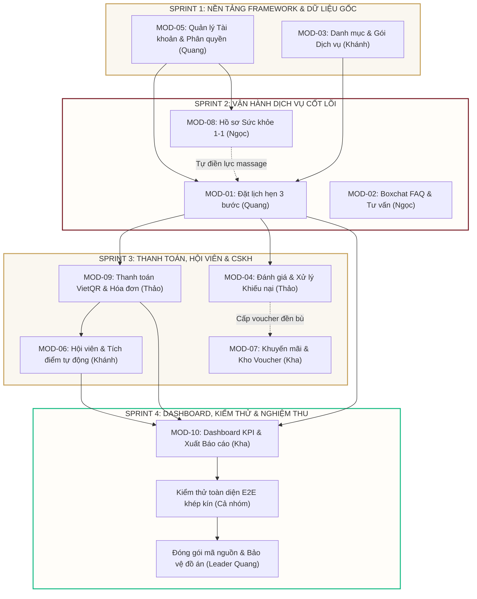

# HỆ THỐNG QUẢN LÝ QUAN HỆ KHÁCH HÀNG & ĐẶT LỊCH DỊCH VỤ SPA (CHAMSPA CRM)

[](https://www.djangoproject.com/)
[](https://www.django-rest-framework.org/)
[](https://getbootstrap.com/)
[](https://www.sqlite.org/)
[](https://vietqr.io/)
[](#-ii-lộ-trình-phát-triển-dự-án-project-roadmap--sprints)

---

> **Tài liệu đặc tả kỹ thuật, hướng dẫn phát triển đồng bộ và chuẩn hóa quy trình làm việc nhóm bằng AI Agent.**  
> *Căn cứ 100% theo Bảng đặc tả chức năng chốt cuối cùng, file đối chiếu `Chốt lỗi.xlsx` và cấu trúc 20 bảng CSDL trong `Sửa database.docx`.*

---

## 📌 I. THÔNG TIN CHUNG DỰ ÁN

* **Tên đề tài:** Hệ thống Quản lý Quan hệ Khách hàng & Đặt lịch dịch vụ Spa (**ChamSPA CRM**)
* **Đơn vị đào tạo:** Trường Đại học Kinh tế – Đại học Đà Nẵng (**DUE**) | **Học phần:** Lập trình Web
* **Doanh nghiệp nghiên cứu:** **ChamSpa & Massage Đà Nẵng** (Massage trị liệu Đông y & Thư giãn chuyên sâu)
* **Địa chỉ cơ sở:** 05 Lê Quang Hoà, Hoà Xuân, Cẩm Lệ, TP. Đà Nẵng
* **Đội ngũ sinh viên thực hiện (Nhóm 5 thành viên):**
  1. **Lê Nhật Quang (Leader):** Phụ trách **MOD-01** (Đặt lịch & Quản lý lịch hẹn), **MOD-05** (Tài khoản & Phân quyền) & Kiến trúc Framework nền tảng.
  2. **Thảo Ngọc (Meo):** Phụ trách **MOD-02** (Boxchat tư vấn & FAQ), **MOD-08** (Hồ sơ sức khỏe 1-1).
  3. **Minh Khánh:** Phụ trách **MOD-03** (Danh mục Dịch vụ & Gallery), **MOD-06** (Hội viên VIP & Tích điểm).
  4. **Thanh Thảo:** Phụ trách **MOD-04** (Phản hồi & Khiếu nại), **MOD-09** (Thanh toán VietQR & Hóa đơn).
  5. **Minh Kha:** Phụ trách **MOD-07** (Thông báo & Khuyến mãi Voucher), **MOD-10** (Dashboard KPI & Báo cáo).

---

## 🛠️ II. KIẾN TRÚC CÔNG NGHỆ & DESIGN SYSTEM

### 1. Ngũ giác Công nghệ (Tech Stack)
1. **Backend & Xử lý nghiệp vụ:** Python 3.10+ kết hợp **Django 6.1.2** và **Django REST Framework (DRF)**. Cấu trúc chuẩn kết hợp viết RESTful API trả về JSON cho client.
2. **Cơ sở dữ liệu (Database):** **SQLite** (`db.sqlite3`) lưu trữ tập trung tại 1 file duy nhất, định nghĩa toàn bộ 20 bảng tại app `core`, dễ dàng đồng bộ qua Git mà không lo xung đột server.
3. **Giao diện & Khung nền (UI/Template):**
   * HTML5 kết hợp hệ thống kế thừa **Django Template (``)** để đồng bộ Sidebar, Topbar, Header, Footer cho cả 5 thành viên.
   * **Bootstrap 5.3** & **Bootstrap Icons v1.11+**, tùy biến bộ màu nhận diện thương hiệu Cham Spa qua file CSS dùng chung `static/css/chamspa.css`.
4. **Xử lý tương tác động (Logic/API Client):** **Vanilla JavaScript (Fetch API thuần)**. Gọi ngầm REST API từ backend để chuyển trạng thái, mở popup modal, nhảy số thống kê, toast notification mà không cần tải lại trang.
5. **Thư viện mở rộng & Cổng thanh toán:**
   * **FullCalendar.js (CDN):** Quản lý hiển thị lịch hẹn động.
   * **Chart.js (CDN):** Vẽ biểu đồ KPI doanh thu, dịch vụ bán chạy tại Dashboard.
   * **SheetJS (`xlsx.full.min.js`) & html2pdf.js:** Xuất báo cáo Excel / PDF trực tiếp tại trình duyệt (Client-side Export).
   * **VietQR (Napas247):** Tạo mã QR chuyển khoản động ngân hàng tự động cập nhật trạng thái đơn hàng.

### 2. Bộ nhận diện thương hiệu (Figma Moodboard Node `857:31`)
* **Màu chủ đạo (Cham Red):** `#781A24` (Đỏ rượu vang hoàng gia)
* **Màu nền tổng thể:** `#F4EFE3` (Be kem ấm áp, thư thái)
* **Màu điểm nhấn (Gold):** `#D0B581` & `#E8D8B5` (Vàng ánh kim cao cấp)
* **Màu Header:** `#3D271D` (Nâu gỗ trầm) | **Footer:** `#000000` (Đen tuyền tuyệt đối)
* **Typography:** Tiêu đề dùng font `Lora` & `Tinos` (Serif quý phái); Nội dung dùng font `Cabin` & `Manrope`.

---

## 🗺️ III. LỘ TRÌNH PHÁT TRIỂN DỰ ÁN (PROJECT ROADMAP & SPRINTS)

Dự án được chia làm **4 Giai đoạn (Sprints)** theo mô hình Agile, dựa trên quan hệ phụ thuộc dữ liệu (Dependencies) giữa 10 phân hệ:



---

## 👥 IV. CƠ CHẾ PHÂN QUYỀN NGƯỜI DÙNG (3 CẤP ĐỘ)

Hệ thống sử dụng Custom User Model kế thừa `AbstractUser`, chia làm 3 phân quyền chuẩn:

| Cấp quyền | Ràng buộc Django | Quyền hạn và Trách nhiệm nghiệp vụ |
| :--- | :--- | :--- |
| **1. Khách hàng** | `is_staff=False`<br>`is_superuser=False` | Đặt lịch trực tuyến, khảo sát thể trạng sức khỏe 1-1, trò chuyện với Chatbot/nhân viên, theo dõi lịch sử lịch hẹn cá nhân, tích điểm thăng hạng hội viên VIP, gửi đánh giá 5 sao và khiếu nại dịch vụ. |
| **2. Nhân viên (Staff)** | `is_staff=True`<br>`is_superuser=False` | Vận hành điều phối lịch hẹn, trực chat Livechat Console tiếp nhận tư vấn khách hàng, phản hồi đánh giá dịch vụ công khai (lưu rõ tên nhân viên), đối soát hóa đơn VietQR và thu tiền tại quầy. |
| **3. Quản lý (Admin)** | `is_superuser=True` | Toàn quyền quản trị hệ thống: Quản lý danh mục & dịch vụ, quản lý tài khoản nhân sự, khóa/mở khóa tài khoản người dùng (`is_active=False`), duyệt/ẩn đánh giá, giải quyết khiếu nại & cấp voucher đền bù, phát hành khuyến mãi, xem Dashboard thống kê KPI và xuất báo cáo. |

---

## 📋 V. TỔNG HỢP 10 PHÂN HỆ NGHIỆP VỤ (MOD-01 ĐẾN MOD-10)

| Mã Module | Tên Phân hệ | Số UC | Phụ trách | Tác nhân chính | Tóm tắt nghiệp vụ cốt lõi | Bảng CSDL trọng tâm |
| :---: | :--- | :---: | :---: | :--- | :--- | :--- |
| **MOD-01** | **Đặt lịch & Quản lý lịch hẹn** | 5 UCs | **Nhật Quang** | Khách hàng, Quản lý, Nhân viên | Quy trình đặt lịch Wizard 3 bước (Service & Giờ -> Thông tin khách & Lực massage -> Áp voucher & Xác nhận). Dời lịch (>= 2h), hủy lịch (nhập STK hoàn tiền). Bảng quản lý lịch hẹn toàn Spa. **Bỏ chọn KTV trên web**. | `Appointment`, `Appointment_Detail`, `Voucher`, `Service` |
| **MOD-02** | **Quản lý Boxchat tư vấn** | 3 UCs | **Thảo Ngọc** | Khách vãng lai, Khách hàng, Nhân viên, Quản lý | Khung chat trực tuyến: Khách vãng lai chat tự động với bot bằng FAQ (không lưu DB); Khách đăng nhập lưu lịch sử; Chuyển tiếp nhân viên tư vấn trực tiếp (hiển thị rõ tên nhân viên); Quản lý FAQ thuần text. | `FAQ`, `Conversation`, `Conversation_message` |
| **MOD-03** | **Quản lý Danh mục Dịch vụ** | 3 UCs | **Minh Khánh** | Khách vãng lai, Khách hàng, Quản lý | Danh sách dịch vụ phân trang, lọc theo danh mục, sắp xếp giá/sao; Trang chi tiết dịch vụ với slider ảnh gallery; Quản trị CRUD danh mục & dịch vụ. Gói Combo coi như dịch vụ thông thường. **Bỏ đếm lượt xem (views_count)**. | `Category`, `Service`, `Service_Image`, `Feedback` |
| **MOD-04** | **Quản lý Phản hồi & Khiếu nại** | 5 UCs | **Thanh Thảo** | Khách hàng, Quản lý, Nhân viên | Khách gửi đánh giá sao (1-5 sao) hoặc khiếu nại cho lịch hẹn `Completed`. Quản lý duyệt/ẩn đánh giá; Nhân viên phản hồi công khai (`replied_by_id`); Xử lý khiếu nại tinh giản, có thể cấp voucher đền bù. | `Feedback`, `Complaint`, `Voucher`, `Appointment` |
| **MOD-05** | **Quản lý Tài khoản & Phân quyền** | 14 UCs | **Nhật Quang** | Khách hàng, Nhân viên, Quản lý, Khách vãng lai | Xác thực phân quyền 3 cấp. Đăng ký (`phone` unique), Đăng nhập (Email/SĐT), Quên mật khẩu, Hồ sơ cá nhân. Mở/Khóa tài khoản bằng **Soft Deactivation (`is_active=False`, không xóa cứng)**. CRUD nhân viên & khách hàng. | `User`, `User_Profile`, `Membership` |
| **MOD-06** | **Quản lý Hội viên & Tích điểm** | 3 UCs | **Minh Khánh** | Khách hàng, Hệ thống tự động, Nhân viên, Quản lý | Thẻ hội viên điện tử VIP (Bạc, Vàng, Kim Cương), thanh tiến trình thăng hạng; Tra cứu hội viên tại quầy; **Tự động tích điểm khi hóa đơn chuyển 'Đã thanh toán' (10.000đ = 1 điểm)**. Bỏ trừ điểm khi hủy đơn, bỏ cronjob sinh nhật. | `Membership`, `Tier`, `Membership_Point`, `Invoice` |
| **MOD-07** | **Quản lý Thông báo & Khuyến mãi** | 5 UCs | **Minh Kha** | Khách hàng, Nhân viên, Quản lý | Bảng tin thông báo hệ thống (bỏ `is_read`); Trang Ưu đãi hiển thị thẻ Card CSS gradient; Quản lý chương trình khuyến mãi và mã Voucher linh hoạt (giảm % có mức trần hoặc tiền mặt cố định, đơn tối thiểu). | `Promotion`, `Voucher`, `Notification`, `User` |
| **MOD-08** | **Quản lý Hồ sơ Sức khỏe** | 2 UCs | **Thảo Ngọc** | Khách hàng, Quản lý, Nhân viên | Khảo sát thể trạng sức khỏe (Body map vùng đau, mức độ đau 1-10, huyết áp, lực massage...). **Chuẩn 1-1 tối giản: bản ghi mới ghi đè bản ghi cũ; bỏ xem lịch sử nhiều lần**. | `User_Health_Profile`, `User`, `Appointment` |
| **MOD-09** | **Quản lý Thanh toán & Hóa đơn** | 3 UCs | **Thanh Thảo** | Khách hàng, Nhân viên Thu ngân, Quản lý | Tạo hóa đơn cho lịch hẹn; **Thanh toán VietQR Napas247 tự động cập nhật trạng thái lịch hẹn sang `Confirmed`**; Đối soát hóa đơn tại quầy; Tra cứu và in hóa đơn bán lẻ CSS Print. Bỏ đếm ngược 10 phút và cronjob hủy đơn. | `Invoice`, `Appointment`, `Membership`, `Membership_Point` |
| **MOD-10** | **Quản lý Dashboard & Báo cáo** | 2 UCs | **Minh Kha** | Quản lý / Ban Giám đốc | Dashboard thống kê thời gian thực với biểu đồ Chart.js (Doanh thu, Lịch hẹn, Top dịch vụ bán chạy). **Xuất báo cáo trực tiếp tại trình duyệt bằng SheetJS & html2pdf.js**. Đã xóa bỏ bảng `Report_export` khỏi CSDL. | `Invoice`, `Appointment`, `Service`, `Membership`, `User` |

---

## ⚙️ VI. BỘ QUY TẮC ĐỒNG BỘ DỮ LIỆU & MÁY TRẠNG THÁI (STATE MACHINE)

Để 5 thành viên ghép nối không bị lỗi logic, toàn bộ hệ thống tuân thủ nghiêm ngặt bảng giá trị trạng thái sau:

| Bảng CSDL | Cột trạng thái | Tập giá trị hợp lệ trong CSDL | Ý nghĩa nghiệp vụ trên giao diện | Điều kiện chuyển trạng thái (Trigger Transition) | Ghi chú kỹ thuật cho Developer |
| :--- | :--- | :--- | :--- | :--- | :--- |
| **`Appointment`** | `status` | `Hold`, `Pending`, `Confirmed`, `In_Progress`, `Completed`, `Cancelled` | • **Hold:** Giữ chỗ chờ quét QR<br>• **Pending:** Đang chờ xác nhận<br>• **Confirmed:** Đã xác nhận<br>• **In_Progress:** Đang làm dịch vụ<br>• **Completed:** Đã hoàn thành<br>• **Cancelled:** Đã hủy | Khách đặt lịch -> `Hold`/`Pending`; Quét QR thành công -> `Confirmed`; Bắt đầu làm -> `In_Progress`; Làm xong -> `Completed`; Khách hủy -> `Cancelled`. | **Tuyệt đối không dùng 'Sắp tới' trong DB**. Frontend hiển thị `Confirmed` thành badge màu xanh biển 'Đã xác nhận'. Giới hạn tối đa 10 khách/slot. |
| **`Invoice`** | `status` | `Chờ xác nhận`, `Đã thanh toán`, `Không hợp lệ` | • **Chờ xác nhận:** Hóa đơn vừa tạo, chờ khách chuyển khoản<br>• **Đã thanh toán:** Tiền đã vào tài khoản Spa<br>• **Không hợp lệ:** Sai cú pháp/hủy đơn | Khách quét VietQR thành công -> `Đã thanh toán`; Nhân viên từ chối hóa đơn -> `Không hợp lệ` (lưu `reason_refuse`). | **Khi Invoice chuyển thành 'Đã thanh toán'**, kích hoạt Django Signal cộng điểm vào `Membership_Point` và nâng hạng thẻ `Tier`. |
| **`Conversation`**| `status` | `Bot xử lý`, `Đang chờ`, `Đang xử lý`, `Kết thúc` | • **Bot xử lý:** Chatbot trả lời tự động<br>• **Đang chờ:** Khách yêu cầu gặp nhân viên<br>• **Đang xử lý:** Nhân viên đã bấm tiếp nhận<br>• **Kết thúc:** Đóng phiên chat | Mở khung chat -> `Bot xử lý`; Bấm 'Chuyển tiếp nhân viên' -> `Đang chờ`; Nhân viên bấm tiếp nhận -> `Đang xử lý`; Hoàn tất -> `Kết thúc`. | Khách vãng lai chỉ chạy session in-memory ở client. **Chỉ ghi CSDL khi user đã đăng nhập**. |
| **`Complaint`** | `status` | `Chờ phân công`, `Đang xử lý`, `Đã xử lý`, `Đã từ chối`, `Chờ liên hệ lại` | • **Chờ phân công:** Khiếu nại mới gửi<br>• **Đang xử lý:** CSKH đang gọi điện/giải quyết<br>• **Đã xử lý:** Đã xử lý xong (có thể cấp voucher)<br>• **Đã từ chối:** Sai sự thật<br>• **Chờ liên hệ lại:** Khách không nghe máy | Khách gửi khiếu nại -> `Chờ phân công`; Quản lý gán staff -> `Đang xử lý`; Nhập `resolution_note` & cấp voucher -> `Đã xử lý`. | Chỉ cho phép gửi khiếu nại cho lịch hẹn có `status='Completed'`. Bồi thường bằng cách tạo `Voucher` có `complaint_id` trỏ về. |
| **`Feedback`** | `status` | `Chờ phản hồi`, `Đã phản hồi`, `Đã ẩn` | • **Chờ phản hồi:** Đánh giá mới tạo<br>• **Đã phản hồi:** Spa đã trả lời công khai<br>• **Đã ẩn:** Đánh giá vi phạm bị ẩn | Khách gửi đánh giá -> `Chờ phản hồi`; Nhân viên trả lời -> `Đã phản hồi`; Quản lý bấm ẩn -> `Đã ẩn`. | Lưu ID nhân viên trả lời vào `Feedback.replied_by_id` và thời điểm vào `replied_at`. Giao diện hiển thị rõ tên nhân viên phản hồi. |
| **`Voucher`** | `status` | `Khả dụng`, `Đã dùng`, `Hết hạn` | • **Khả dụng:** Mã còn hạn và chưa dùng<br>• **Đã dùng:** Đã áp dụng thanh toán<br>• **Hết hạn:** Quá ngày `expiry_date` | Tạo mã -> `Khả dụng`; Khách áp mã và lịch hoàn thành -> `Đã dùng`; Quá hạn -> `Hết hạn`. | Kiểm tra `order_total >= min_order_amount`. Nếu `discount_type='PERCENT'`, tiền giảm = `min(order_total * discount_value / 100, max_discount_amount)`. |
| **`User`** | `is_active` | `True`, `False` | • **True:** Tài khoản đang hoạt động bình thường<br>• **False:** Tài khoản bị khóa / vô hiệu hóa | Quản lý bấm 'Khóa tài khoản' -> `False`; Quản lý bấm 'Mở khóa' -> `True`. | **TUYỆT ĐỐI KHÔNG XÓA CỨNG (DELETE FROM User)**. Chức năng 'Xóa' trên web thực chất là chuyển `is_active=False` để tránh sập khóa ngoại. |
| **`Promotion`** | `status` | `Sắp diễn ra`, `Đang hoạt động`, `Hết hạn` | • **Sắp diễn ra:** Trước ngày `valid_from`<br>• **Đang hoạt động:** Trong thời gian áp dụng<br>• **Hết hạn:** Sau ngày `valid_until` | So sánh thời điểm hiện tại `timezone.now()` với `valid_from` và `valid_until`. | Hiển thị trên website bằng thẻ Card CSS gradient đẹp mắt, không bắt buộc upload ảnh banner. |

---

## 📊 VII. MA TRẬN PHÂN CHIA NHIỆM VỤ 45 USE CASES (5 THÀNH VIÊN)

<details>
<summary><b>👉 Nhấn vào đây để xem toàn bộ danh sách 45 Use Cases phân chia cho 5 thành viên</b></summary>

| STT | Module | Mã UC | Tên Use Case | Phụ trách | Nhiệm vụ Frontend (Giao diện) | Nhiệm vụ Backend (Logic / API) | Bảng CSDL liên quan |
| :---: | :---: | :---: | :--- | :---: | :--- | :--- | :--- |
| 1 | MOD-01 | UC-1.1 | Đặt lịch hẹn trực tuyến | **Nhật Quang** | Wizard Form 3 bước đặt lịch. Bỏ chọn KTV trên web. | API kiểm tra slot 10 khách/giờ, tính chiết khấu voucher, tạo Appointment trong transaction. | `Appointment`, `Appointment_Detail`, `Voucher`, `Service` |
| 2 | MOD-01 | UC-1.2 | Quản lý lịch cá nhân | **Nhật Quang** | Giao diện thẻ lịch hẹn 4 tab, hiển thị trạng thái badge màu, nút dời/hủy. | API trả về danh sách lịch hẹn của user đang đăng nhập kèm dịch vụ prefetched. | `Appointment`, `Appointment_Detail`, `Service` |
| 3 | MOD-01 | UC-1.3 | Dời lịch hẹn | **Nhật Quang** | Modal dời lịch với date picker và lưới chọn khung giờ trống. | API kiểm tra điều kiện >= 2h, kiểm tra slot trống giờ mới và cập nhật Appointment. | `Appointment`, `Notification` |
| 4 | MOD-01 | UC-1.4 | Hủy lịch hẹn | **Nhật Quang** | Modal hủy lịch gồm trường `cancel_reason` và `refund_account_number`. | API nhận lý do và STK hoàn tiền, chuyển status='Cancelled', tạo Notification. | `Appointment`, `Notification` |
| 5 | MOD-01 | UC-1.5 | Quản lý danh sách lịch hẹn | **Nhật Quang** | Bảng Data Table có tìm kiếm, bộ lọc trạng thái, chuyển nhanh trạng thái. | API phân trang danh sách lịch hẹn, filter đa điều kiện, cập nhật status an toàn. | `Appointment`, `Appointment_Detail`, `Service`, `User` |
| 6 | MOD-02 | UC-2.1 | Trò chuyện với Chatbot tự động | **Thảo Ngọc** | Floating Chat Widget lưu tạm LocalStorage cho khách vãng lai, menu câu hỏi nhanh. | API tìm FAQ theo keywords; khách đăng nhập lưu `Conversation`, vãng lai chỉ trả JSON text. | `FAQ`, `Conversation`, `Conversation_message` |
| 7 | MOD-02 | UC-2.2 | Trò chuyện trực tiếp với nhân viên | **Thảo Ngọc** | Chat Console cho nhân viên tư vấn (danh sách chờ, khung chat trực tiếp, tiếp nhận). | API/Polling xử lý gửi/nhận tin nhắn, gán `staff_id`, hiển thị tên nhân viên tư vấn. | `Conversation`, `Conversation_message`, `User` |
| 8 | MOD-02 | UC-2.3 | Quản lý kịch bản Chatbot (FAQ) | **Thảo Ngọc** | Bảng quản lý FAQ và Modal Form thêm/sửa câu hỏi thuần text. | ModelForm/Serializer và API CRUD cho bảng FAQ, hỗ trợ tìm kiếm category. | `FAQ` |
| 9 | MOD-03 | UC-3.1 | Xem danh sách dịch vụ | **Minh Khánh** | Trang danh sách dịch vụ: lọc danh mục ngang, lưới thẻ responsive, phân trang, sắp xếp. | API trả về danh sách Service lọc theo category, order_by giá/rating, phân trang. | `Category`, `Service` |
| 10 | MOD-03 | UC-3.2 | Xem chi tiết dịch vụ | **Minh Khánh** | Giao diện chi tiết dịch vụ: Slider ảnh gallery, tóm tắt giá, mô tả liệu trình, feedback. | API chi tiết Service theo slug kèm prefetch `Service_Image` và `Feedback` đã duyệt. | `Service`, `Service_Image`, `Category`, `Feedback` |
| 11 | MOD-03 | UC-3.3 | Quản lý danh mục & dịch vụ | **Minh Khánh** | Màn hình Quản trị Dịch vụ gồm tab Quản lý Danh mục và tab Quản lý Dịch vụ. | ViewSet CRUD Category (`updated_at`) và CRUD Service kèm upload nhiều ảnh gallery. | `Category`, `Service`, `Service_Image` |
| 12 | MOD-04 | UC-4.1 | Gửi đánh giá / khiếu nại dịch vụ | **Thanh Thảo** | Modal Đánh giá sao (1-5 sao, tags) và Modal Khiếu nại (`description`, tải bằng chứng). | API kiểm tra lịch hẹn `Completed`, kiểm tra unique feedback, lưu JSON mảng URL ảnh. | `Feedback`, `Complaint`, `Appointment` |
| 13 | MOD-04 | UC-4.2 | Duyệt / Ẩn đánh giá | **Thanh Thảo** | Bảng đánh giá với bộ lọc theo sao (1-5), nút Ẩn/Hiện nhanh kèm icon xác nhận. | API cập nhật Feedback.status ('Đã ẩn' / 'Chờ phản hồi'), ẩn khỏi trang chi tiết dịch vụ. | `Feedback`, `Service`, `Appointment` |
| 14 | MOD-04 | UC-4.3 | Phản hồi đánh giá của khách | **Thanh Thảo** | Modal nhập phản hồi và badge 'Đã trả lời bởi [Tên nhân viên]' trên bảng admin & web. | API nhận reply, gán `replied_by_id = request.user`, cập nhật `replied_at`. | `Feedback`, `User` |
| 15 | MOD-04 | UC-4.4 | Xử lý khiếu nại dịch vụ | **Thanh Thảo** | Màn hình chi tiết khiếu nại: phân công nhân viên, ô Ghi chú xử lý, checkbox Cấp voucher. | API lưu `resolution_note`, tự động tạo Voucher đền bù (gắn `complaint_id`) trong transaction. | `Complaint`, `Voucher`, `Notification`, `User` |
| 16 | MOD-04 | UC-4.5 | Theo dõi tiến độ khiếu nại | **Thanh Thảo** | Danh sách Khiếu nại với Timeline trạng thái trực quan (Gửi -> Đang xử lý -> Hoàn tất). | API trả về danh sách khiếu nại phân quyền (user xem của mình, staff xem toàn bộ). | `Complaint`, `Voucher`, `Appointment` |
| 17 | MOD-05 | UC-5.1 | Đăng ký tài khoản | **Nhật Quang** | Form Đăng ký validate realtime (email, regex SĐT 10 số, độ mạnh mật khẩu). | API tạo User, băm mật khẩu PBKDF2, tự động tạo `User_Profile` và `Membership`. | `User`, `User_Profile`, `Membership` |
| 18 | MOD-05 | UC-5.2 | Đăng nhập hệ thống | **Nhật Quang** | Form Đăng nhập bằng Email hoặc Số điện thoại, checkbox Ghi nhớ, link Quên mật khẩu. | Custom Auth Backend authenticate bằng email/phone, kiểm tra `is_active`, phân luồng vai trò. | `User` |
| 19 | MOD-05 | UC-5.3 | Quên / Đặt lại mật khẩu | **Nhật Quang** | Trang Quên mật khẩu và Đặt lại mật khẩu mới có validate độ mạnh mật khẩu. | Sử dụng `PasswordResetTokenGenerator` tạo token an toàn gửi qua email. | `User` |
| 20 | MOD-05 | UC-5.4 | Quản lý hồ sơ cá nhân | **Nhật Quang** | Trang Thông tin cá nhân có khung ảnh đại diện tròn xem trước, form responsive. | API trả về và cập nhật User + User_Profile, upload avatar vào `media/avatars/`. | `User`, `User_Profile` |
| 21 | MOD-05 | UC-5.5 | Đăng xuất tài khoản | **Nhật Quang** | Sự kiện click Đăng xuất, xóa token/session khỏi client và reload về trang chủ. | Gọi hàm `django.contrib.auth.logout(request)` xóa sạch session phía server. | `User` |
| 22 | MOD-05 | UC-5.6 | Quản lý danh sách tài khoản User | **Nhật Quang** | Bảng Danh sách Người dùng với phân trang, tìm kiếm realtime, lọc vai trò/trạng thái. | API danh sách User kết hợp User_Profile, search name/email/phone, filter is_staff/is_active. | `User`, `User_Profile` |
| 23 | MOD-05 | UC-5.7 | Mở / Khóa tài khoản người dùng | **Nhật Quang** | Nút Toggle Status (Khóa/Mở khóa) có hộp thoại xác nhận cảnh báo an toàn. | API chuyển đổi `is_active = not is_active`, ngăn chặn thao tác trên chính user request. | `User` |
| 24 | MOD-05 | UC-5.8 | Xem thông tin khách hàng 360 | **Nhật Quang** | Màn hình Hồ sơ Khách hàng Dashboard 360: thẻ thông tin, thẻ VIP, tab lịch sử đặt lịch. | API tổng hợp dữ liệu User, Profile, Membership, lịch sử Appointment và Feedback. | `User`, `User_Profile`, `Membership`, `Tier`, `Appointment` |
| 25 | MOD-05 | UC-5.9 | Cập nhật thông tin khách hàng | **Nhật Quang** | Modal Chỉnh sửa thông tin khách hàng có kiểm tra dữ liệu đầu vào. | API cập nhật User.name, User.phone, User_Profile.birthday, gender validate unique phone. | `User`, `User_Profile` |
| 26 | MOD-05 | UC-5.10 | Khóa tài khoản khách hàng | **Nhật Quang** | Nút 'Khóa tài khoản' màu cam/đỏ kèm icon ổ khóa (thay thế nút Xóa). | API gán `User.is_active = False`, không chạy lệnh `user.delete()`. | `User` |
| 27 | MOD-05 | UC-5.11 | Tạo tài khoản nhân viên mới | **Nhật Quang** | Modal Form Tạo nhân viên mới gồm đầy đủ các trường thông tin cần thiết. | API tạo User với `is_staff=True`, băm mật khẩu và tạo `User_Profile`. | `User`, `User_Profile` |
| 28 | MOD-05 | UC-5.12 | Xem danh sách nhân viên | **Nhật Quang** | Bảng Quản lý Nhân sự với bộ lọc trạng thái và thanh tìm kiếm. | API trả về danh sách User có `is_staff=True`. | `User`, `User_Profile` |
| 29 | MOD-05 | UC-5.13 | Cập nhật thông tin nhân viên | **Nhật Quang** | Modal Form Chỉnh sửa thông tin nhân viên, cấp lại mật khẩu mới. | API cập nhật thông tin nhân viên, hỗ trợ đặt lại mật khẩu mới. | `User`, `User_Profile` |
| 30 | MOD-05 | UC-5.14 | Khóa tài khoản nhân viên | **Nhật Quang** | Đổi nhãn nút từ 'Xóa nhân viên' thành 'Khóa tài khoản' có hộp thoại xác nhận. | API gán `User.is_active = False`, bảo vệ an toàn các bản ghi liên kết khóa ngoại. | `User` |
| 31 | MOD-06 | UC-6.1 | Xem thẻ hội viên & Tiến trình thăng hạng | **Minh Khánh** | Thẻ Hội viên điện tử (Digital VIP Card), thanh Progress Bar, bảng lịch sử điểm. | API tính tiến trình thăng hạng và trả về lịch sử `Membership_Point`. | `Membership`, `Tier`, `Membership_Point`, `User` |
| 32 | MOD-06 | UC-6.2 | Tra cứu thông tin hội viên | **Minh Khánh** | Thanh tìm kiếm nhanh SĐT có Auto-complete gợi ý và thẻ tóm tắt hạng hội viên. | API tìm kiếm Membership dựa trên phone/name, trả về chiết khấu đặc quyền. | `Membership`, `Tier`, `User` |
| 33 | MOD-06 | UC-6.3 | Tự động tích điểm & Thăng hạng | **Minh Khánh** | Thông báo Toast 'Bạn vừa được cộng +X điểm thưởng' trên màn hình hóa đơn thành công. | Django Signal (post_save Invoice) cộng điểm, cập nhật `current_points`, thăng hạng Tier. | `Membership`, `Membership_Point`, `Tier`, `Invoice`, `Notification` |
| 34 | MOD-07 | UC-7.1 | Xem danh sách thông báo | **Minh Kha** | Dropdown thông báo tại quả chuông và Trang danh sách thông báo dạng Timeline bảng tin. | API trả về danh sách Notification theo `user_id`, order_by `-created_at`. Bỏ `is_read`. | `Notification` |
| 35 | MOD-07 | UC-7.2 | Xem danh sách ưu đãi & Kho Voucher | **Minh Kha** | Trang Ưu đãi 2 tab: Tab Khuyến mãi (Card gradient) và Tab Ví Voucher (nút copy mã). | API trả về danh sách Promotion đang hoạt động và danh sách Voucher hợp lệ của user. | `Promotion`, `Voucher` |
| 36 | MOD-07 | UC-7.3 | Quản lý thông báo hệ thống | **Minh Kha** | Bảng Quản lý Thông báo và Modal Soạn thông báo chọn người nhận (Tất cả / Cá nhân). | API tạo Notification, hỗ trợ `bulk_create` nếu chọn gửi Tất cả khách hàng. | `Notification`, `User`, `Promotion` |
| 37 | MOD-07 | UC-7.4 | Quản lý khuyến mãi & Mã Voucher | **Minh Kha** | Modal Form Tạo Voucher thông minh (chọn % hiện trần, chọn Fixed ẩn trần). | API CRUD Promotion và CRUD Voucher, validate nếu % thì value <= 100, min_order >= 0. | `Promotion`, `Voucher`, `User` |
| 38 | MOD-07 | UC-7.5 | Tự động gửi thông báo hệ thống | **Minh Kha** | Tích hợp hiển thị Notification badge và popup toast realtime khi có tin mới. | Viết hàm helper `create_system_notification(user, title, content)` dùng chung toàn Spa. | `Notification`, `User` |
| 39 | MOD-08 | UC-8.1 | Cập nhật hồ sơ sức khỏe 1-1 | **Thảo Ngọc** | Form Khảo sát Sức khỏe: Sơ đồ Body map chọn vùng đau, slider chọn mức đau 1-10. | API `update_or_create` cho `User_Health_Profile`, lưu mảng JSON focus_areas, conditions. | `User_Health_Profile`, `User` |
| 40 | MOD-08 | UC-8.2 | Xem hồ sơ sức khỏe cá nhân (1-1) | **Thảo Ngọc** | Thẻ Tóm tắt Sức khỏe Infographic có cảnh báo y tế (badge vàng/đỏ) cho nhân viên. | API trả về `User_Health_Profile` theo user_id, phân quyền: user xem của mình, staff xem lịch hẹn. | `User_Health_Profile`, `User`, `Appointment` |
| 41 | MOD-09 | UC-9.1 | Thanh toán hóa đơn trực tuyến (VietQR) | **Thanh Thảo** | Khung hiển thị mã QR động chuẩn VietQR.io, copy STK/cú pháp, nút 'Đã chuyển khoản'. | Tích hợp VietQR động, API xác nhận cập nhật Invoice='Đã thanh toán', Appointment='Confirmed'. | `Invoice`, `Appointment`, `Membership`, `Membership_Point` |
| 42 | MOD-09 | UC-9.2 | Đối soát hóa đơn tại quầy | **Thanh Thảo** | Bảng Đối soát Hóa đơn: lọc trạng thái, modal chi tiết, nút 'Xác nhận' và 'Từ chối (lý do)'. | API cập nhật Invoice.status, validate kế toán, kích hoạt signal tích điểm sang MOD-06. | `Invoice`, `Appointment`, `User` |
| 43 | MOD-09 | UC-9.3 | Theo dõi & Tra cứu danh sách hóa đơn | **Thanh Thảo** | Giao diện Phiếu thu / Hóa đơn bán lẻ điện tử chuẩn in ấn (CSS Print) đẹp mắt. | API trả về danh sách hóa đơn phân quyền kèm chi tiết Appointment_Detail và Service. | `Invoice`, `Appointment`, `Service` |
| 44 | MOD-10 | UC-10.1 | Xem Dashboard thống kê tổng quan | **Minh Kha** | Chart.js 3 biểu đồ (Line, Bar, Doughnut), 4 widget thẻ KPI số to nổi bật, lọc thời gian. | API thống kê: aggregate/annotate (Sum, Count) trên Invoice đã thanh toán và Appointment completed. | `Invoice`, `Appointment`, `Service`, `Membership`, `User` |
| 45 | MOD-10 | UC-10.2 | Xuất báo cáo tại trình duyệt | **Minh Kha** | Tích hợp SheetJS (`xlsx`) và html2pdf.js, viết hàm `exportTableToExcel()` và `exportToPDF()`. | API trả về dữ liệu thô JSON để frontend kết xuất bảng HTML xuất file trực tiếp. | Không tác động CSDL |

</details>

---

## 🔌 VIII. HỢP ĐỒNG GIAO TIẾP API (API CONTRACTS) TIÊU BIỂU

Toàn bộ API tuân thủ chuẩn RESTful, trả về định dạng JSON với các mã trạng thái HTTP chuẩn (`200 OK`, `201 Created`, `400 Bad Request`, `403 Forbidden`, `404 Not Found`):

<details>
<summary><b>👉 Nhấn vào đây để xem chi tiết 20 API Endpoints kết nối Frontend & Backend</b></summary>

| STT | Phân hệ | Mã UC | Method | URL Endpoint | Request Body / Params (JSON) | Response Data (JSON) | Quyền truy cập |
| :---: | :--- | :---: | :---: | :--- | :--- | :--- | :--- |
| 1 | Module 1 | UC-1.1 | **POST** | `/api/appointments/create/` | `{"service_id": 1, "appointment_date": "2026-10-16", "time_slot": "14:00", "total_guests": 2, "customer_name": "Nguyễn Văn A", "customer_phone": "0905123456", "customer_email": "vana@gmail.com", "voucher_code": "CHAMSPA10", "guests": [{"guest_index": 1, "gender": "Nam", "massage_pressure": "Lực vừa"}]}` | `{"status": "success", "appointment_code": "AP-20261016-01", "total_price": 750000, "discount_applied": 75000, "status": "Hold"}` | Public (Khách vãng lai & Thành viên) |
| 2 | Module 1 | UC-1.2 | **GET** | `/api/my-appointments/` | *Params:* `status=Confirmed` (Tùy chọn) | `{"appointments": [{"id": 10, "appointment_code": "AP-20261016-01", "service_name": "Massage Body Trị Liệu", "appointment_date": "2026-10-16", "time_slot": "14:00", "total_price": 750000, "status": "Confirmed"}]}` | IsAuthenticated (Khách đăng nhập) |
| 3 | Module 1 | UC-1.3 | **POST** | `/api/appointments/{id}/reschedule/` | `{"new_date": "2026-10-18", "new_time_slot": "16:00"}` | `{"status": "success", "message": "Dời lịch hẹn thành công", "appointment_code": "AP-20261016-01"}` | IsOwner (Chủ lịch hẹn) |
| 4 | Module 1 | UC-1.4 | **POST** | `/api/appointments/{id}/cancel/` | `{"cancel_reason": "Bận công tác", "refund_account_number": "1028475899 - VCB"}` | `{"status": "success", "message": "Đã ghi nhận yêu cầu hủy. Kế toán sẽ hoàn tiền.", "status": "Cancelled"}` | IsOwner (Chủ lịch hẹn) |
| 5 | Module 1 | UC-1.5 | **GET, PUT** | `/api/admin/appointments/` | *PUT:* `{"status": "In_Progress" / "Completed"}` | `{"status": "success", "updated_status": "Completed"}` | IsStaff / IsSuperuser |
| 6 | Module 2 | UC-2.1 | **POST** | `/api/chat/bot-reply/` | `{"message": "Cho mình xin bảng giá massage body"}` | `{"reply": "Dạ, gói Massage Body giá từ 350.000đ - 650.000đ...", "suggested_actions": ["Xem bảng giá", "Gặp nhân viên"]}` | Public (Vãng lai chạy in-memory) |
| 7 | Module 2 | UC-2.2 | **POST** | `/api/chat/conversations/{id}/messages/` | `{"content": "Dạ em là Thảo tư vấn viên, em có thể hỗ trợ gì ạ?", "message_type": "TEXT"}` | `{"message_id": 105, "sender_type": "Staff", "sender_name": "Thanh Thảo", "created_at": "2026-10-16T14:05:00"}` | Khách sở hữu hoặc Staff tiếp nhận |
| 8 | Module 3 | UC-3.1 | **GET** | `/api/services/` | *Params:* `category_slug=massage-body&sort=price_asc&page=1` | `{"count": 12, "results": [{"id": 1, "name": "Massage Body Đá Nóng 90p", "slug": "massage-body-da-nong-90p", "price_vnd": 550000, "duration_minutes": 90, "rating_avg": 4.9}]}` | Public |
| 9 | Module 3 | UC-3.2 | **GET** | `/api/services/{slug}/` | Không | `{"id": 1, "name": "Massage Body Đá Nóng 90p", "price_vnd": 550000, "images": ["/media/1.jpg"], "feedbacks": [...]}` | Public |
| 10 | Module 4 | UC-4.1 | **POST** | `/api/feedback/submit/` | `{"appointment_id": 10, "rating": 5, "tags": ["KTV tay nghề tốt"], "comment": "Trải nghiệm tuyệt vời"}` | `{"status": "success", "feedback_code": "FB-20261016-01"}` | IsOwner (Lịch hẹn `Completed`) |
| 11 | Module 4 | UC-4.3 | **POST** | `/api/admin/feedback/{id}/reply/` | `{"reply": "Dạ ChamSpa chân thành cảm ơn quý khách!"}` | `{"status": "success", "replied_by": "Thanh Thảo", "replied_at": "2026-10-16T15:30:00"}` | IsStaff |
| 12 | Module 4 | UC-4.4 | **POST** | `/api/admin/complaints/{id}/resolve/` | `{"resolution_note": "Đã gọi điện xin lỗi khách", "status": "Đã xử lý", "issue_voucher": true, "voucher_data": {"discount_type": "FIXED", "discount_value": 100000}}` | `{"status": "success", "voucher_code": "COMP-KN001-DENBU"}` | Staff CSKH phụ trách / Admin |
| 13 | Module 5 | UC-5.1 | **POST** | `/api/auth/register/` | `{"name": "Trần Thị B", "email": "thib@gmail.com", "phone": "0912345678", "password": "Password123!"}` | `{"status": "success", "user_id": 15}` | Public |
| 14 | Module 5 | UC-5.2 | **POST** | `/api/auth/login/` | `{"username": "0912345678", "password": "Password123!"}` | `{"status": "success", "user": {"id": 15, "name": "Trần Thị B", "role": "Customer"}, "redirect_url": "/"}` | Public |
| 15 | Module 5 | UC-5.7 | **PUT** | `/api/admin/users/{id}/toggle-status/` | Không | `{"status": "success", "is_active": false, "message": "Đã khóa tài khoản thành công"}` | IsSuperuser (Admin) |
| 16 | Module 6 | UC-6.1 | **GET** | `/api/membership/my-card/` | Không | `{"tier_name": "Hạng Bạc", "discount_percent": 5, "current_points": 120, "total_spent": 1200000, "history": [...]}` | IsAuthenticated |
| 17 | Module 7 | UC-7.4 | **POST** | `/api/admin/vouchers/create/` | `{"voucher_code": "CHAMSPA20", "discount_type": "PERCENT", "discount_value": 20, "max_discount_amount": 150000, "min_order_amount": 500000, "expiry_date": "2026-12-31T23:59:59"}` | `{"status": "success", "voucher_id": 8}` | IsSuperuser (Admin) |
| 18 | Module 8 | UC-8.1 | **POST, PUT** | `/api/health-profile/` | `{"height_cm": 165, "weight_kg": 55, "blood_pressure": "Bình thường", "focus_areas": ["Vai gáy"], "massage_pressure": "Lực vừa", "pain_level": 7}` | `{"status": "success", "message": "Cập nhật hồ sơ sức khỏe thành công"}` | IsAuthenticated |
| 19 | Module 9 | UC-9.1 | **POST** | `/api/payment/confirm-qr/` | `{"appointment_code": "AP-20261016-01", "amount": 750000}` | `{"status": "success", "invoice_status": "Đã thanh toán", "appointment_status": "Confirmed"}` | Chủ lịch hẹn / Webhook |
| 20 | Module 10 | UC-10.1 | **GET** | `/api/admin/dashboard-stats/` | *Params:* `period=this_month` | `{"total_revenue": 145000000, "total_appointments": 210, "completed_rate": 92.5, "revenue_chart": {...}, "top_services": [...]}` | IsSuperuser (Admin) |

</details>

---

## 🗄️ IX. TỪ ĐIỂN DỮ LIỆU 20 BẢNG CƠ SỞ DỮ LIỆU CHUẨN

Toàn bộ 20 bảng CSDL đã được định nghĩa chuẩn xác 100% trong file duy nhất [`core/models.py`](file:///d:/1.+DUE/05.+Kì+1+Năm+3/Lập+trình+web/CHAMSPA+CRM/core/models.py):

```text
core/models.py (Tập trung toàn bộ 20 Bảng CSDL của hệ thống)
├── [MOD-05] User (Custom User Model kế thừa AbstractUser, phone Unique, Soft Deactivation is_active)
├── [MOD-05] UserProfile (Quan hệ 1-1 với User, lưu avatar, ngày sinh, giới tính)
├── [MOD-08] UserHealthProfile (Quan hệ 1-1 với User, Body map JSON, huyết áp, lực massage, ghi đè 1-1)
├── [MOD-03] Category (Danh mục liệu trình: name, slug, status, updated_at)
├── [MOD-03] Service (Gói dịch vụ & combo: price_vnd, duration_minutes, rating_avg, thumbnail_url)
├── [MOD-03] ServiceImage (Gallery ảnh thực tế của dịch vụ: service_id, image_url)
├── [MOD-06] Tier (Hạng thẻ VIP: Thành viên, Hạng Bạc, Hạng Vàng, Kim Cương, discount_percent)
├── [MOD-06] Membership (Thẻ hội viên điện tử: user_id 1-1, current_points, total_spent)
├── [MOD-06] MembershipPoint (Lịch sử biến động điểm: membership_id, points_amount, reason_description)
├── [MOD-07] Promotion (Chương trình ưu đãi toàn Spa: valid_from, valid_until, status)
├── [MOD-07] Voucher (Mã giảm giá linh hoạt: discount_type PERCENT/FIXED, max_discount_amount, min_order_amount)
├── [MOD-07] Notification (Bảng tin thông báo hệ thống: user_id, title, content, bỏ is_read)
├── [MOD-01] Appointment (Lịch hẹn: appointment_code, user_id, total_guests, cancel_reason, refund_account_number)
├── [MOD-01] AppointmentDetail (Chi tiết từng khách: guest_index, gender, massage_pressure)
├── [MOD-09] Invoice (Hóa đơn VietQR: appointment_id 1-1, amount, status, reason_refuse)
├── [MOD-04] Feedback (Đánh giá 5 sao: appointment_id 1-1, rating, comment, replied_by_id, replied_at)
├── [MOD-04] Complaint (Khiếu nại: appointment_id, description, attached_proofs, resolution_note)
├── [MOD-02] FAQ (Câu hỏi thường gặp dạng text: faq_code, category, question, keywords, answer)
├── [MOD-02] Conversation (Phiên chat: customer_id, staff_id, status Bot xử lý/Đang chờ/Đang xử lý/Kết thúc)
└── [MOD-02] ConversationMessage (Tin nhắn trao đổi: conversation_id, sender_type, content)
```
*(Ghi chú: Bảng `Report_export` đã được xóa bỏ hoàn toàn khỏi CSDL theo phê duyệt chốt lỗi, chuyển sang xuất file trực tiếp tại trình duyệt).*

---

## 🤖 X. QUY TRÌNH DÀNH CHO 4 THÀNH VIÊN DÙNG AI AGENT ĐỂ CODE MODULE

Để cả 5 thành viên làm việc độc lập mà **không bị xung đột Git và không làm hỏng Database**, tất cả thành viên bắt buộc phải tuân thủ quy trình sau:

### 1. Chuẩn bị môi trường & Clone dự án
1. Lên GitHub copy link repo: `https://github.com/nhatquanggle-maker/chamspacrm.git`
2. Mở IDE (Antigravity hoặc PyCharm), mở Terminal và clone code về máy:
   ```bash
   git clone https://github.com/nhatquanggle-maker/chamspacrm.git
   cd chamspacrm
   ```
3. Tạo nhánh làm việc riêng cho module của mình (**TUYỆT ĐỐI KHÔNG CODE TRÊN `main`**):
   * Thảo Ngọc: `git checkout -b feature/module-02` (cho Boxchat) hoặc `feature/module-08` (cho Sức khỏe)
   * Minh Khánh: `git checkout -b feature/module-03` (cho Dịch vụ) hoặc `feature/module-06` (cho Hội viên)
   * Thanh Thảo: `git checkout -b feature/module-04` (cho Đánh giá) hoặc `feature/module-09` (cho Thanh toán)
   * Minh Kha: `git checkout -b feature/module-07` (cho Khuyến mãi) hoặc `feature/module-10` (cho Dashboard)

### 2. Mẫu Prompt chuẩn để gửi cho AI Agent của bạn

Copy toàn bộ đoạn văn bản dưới đây và dán vào AI Agent của bạn để AI hiểu đúng ngữ cảnh và code chính xác:

```text
Tôi là [Điền Tên Bạn: Thảo Ngọc / Minh Khánh / Thanh Thảo / Minh Kha], được phân công thực hiện [Điền Tên Module: ví dụ Module 3 Quản lý Danh mục Dịch vụ].

HÃY ĐỌC TOÀN BỘ FILE README.MD VÀ TOÀN BỘ SOURCE CODE DỰ ÁN TẠI THƯ MỤC NÀY ĐỂ HIỂU NGHIỆP VỤ VÀ KIẾN TRÚC HỆ THỐNG CHAMSPA CRM.

QUY TẮC PHÁT TRIỂN SỐNG CÒN (BẮT BUỘC TUÂN THỦ 100%):
1. KHÔNG ĐƯỢC TẠO MODEL MỚI, KHÔNG ĐƯỢC CHẠY LỆNH 'makemigrations' HOẶC 'migrate'. Toàn bộ 20 bảng CSDL đã được Leader Nhật Quang định nghĩa chuẩn tập trung trong 'core/models.py' và có sẵn trong 'db.sqlite3'. Mọi Model chỉ được phép import từ 'core.models' (ví dụ: from core.models import Service, Category, User,...). Khi cần import User, dùng: from core.models import User hoặc from django.contrib.auth import get_user_model.
2. KHÔNG ĐƯỢC THÊM, SỬA, XÓA TRONG THƯ MỤC CỦA CÁC MODULE KHÁC VÀ KHÔNG SỬA CÁC FILE CẤU HÌNH TỔNG (config/settings.py, config/urls.py, core/models.py, static/css/chamspa.css).
3. TẤT CẢ CODE CỦA TÔI CHỈ ĐƯỢC PHÉP NẰM TRONG 2 NƠI:
   - Thư mục app của tôi: [Ví dụ: services/ (views.py, urls.py, api.py, serializers.py)]
   - Thư mục templates của tôi: [Ví dụ: templates/services/]
4. GIAO DIỆN PHẢI KẾ THỪA TỪ CÁC MASTER LAYOUT ĐÃ CÓ SẴN TRONG templates/layouts/ ( hoặc 'customer_layout.html', 'staff_layout.html', 'admin_layout.html').
5. PHONG CÁCH GIAO DIỆN: Sử dụng Bootstrap 5.3 + Bootstrap Icons kết hợp bộ biến màu Cham Spa trong static/css/chamspa.css (Màu đỏ chủ đạo: var(--cham-red) #781A24, Màu nền: var(--cham-bg) #F4EFE3, Màu vàng gold: var(--cham-gold) #D0B581, Font chữ tiêu đề: Lora, Nội dung: Cabin).
6. TƯƠNG TÁC ĐỘNG: Dùng Vanilla JavaScript (Fetch API thuần) để gọi API ngầm, cập nhật DOM không reload trang, hiển thị modal popup, toast thông báo.

NHIỆM VỤ CỦA BẠN:
- Căn cứ vào bảng 45 Use Cases trong README.md cho phân hệ của tôi.
- Thiết kế hoàn thiện toàn bộ Giao diện (Templates HTML) và Logic xử lý (Views, DRF API Serializers) khớp 100% với yêu cầu nghiệp vụ và các giá trị trạng thái chuẩn trong README.md.
```

### 3. Kiểm thử & Đẩy code lên GitHub
1. Sau khi AI Agent code xong, bạn tự mở trình duyệt test kỹ:
   * **Giao diện (Frontend):** Bấm thử các nút bấm, modal popup, thanh lọc, xem trên máy tính và điện thoại.
   * **Xử lý ngầm (Backend):** Kiểm tra xem dữ liệu có lưu đúng vào CSDL không, API có trả về dữ liệu chuẩn không.
2. Kiểm tra lại Git status xem có sửa nhầm file nào ngoài module của mình không:
   ```bash
   git status
   ```
3. Commit và đẩy code lên nhánh feature của bạn:
   ```bash
   git add .
   git commit -m "feat(module-XX): Hoàn thành giao diện và logic phân hệ [Tên Module]"
   git push origin feature/module-XX
   ```
4. Báo cho Leader Nhật Quang để Quang kiểm tra (Review Code) và merge vào nhánh `main` an toàn!

---

## 🚀 XI. HƯỚNG DẪN CÀI ĐẶT & CHẠY LOCAL (DEVELOPER GUIDE)

```bash
# 1. Di chuyển vào thư mục dự án
cd "CHAMSPA CRM"

# 2. Tạo và kích hoạt môi trường ảo
python -m venv .venv
# Trên Windows PowerShell:
.venv\Scripts\Activate.ps1
# Hoặc trên Windows Command Prompt:
.venv\Scripts\activate.bat

# 3. Cài đặt các thư viện cần thiết
pip install -r requirements.txt

# 4. Kiểm tra hệ thống (Đạt 0 lỗi)
python manage.py check

# 5. Khởi chạy máy chủ phát triển
python manage.py runserver
```

* **Trang chủ Website:** `http://127.0.0.1:8000/`
* **Trang Quản trị Django Admin:** `http://127.0.0.1:8000/admin/`
* **Tài khoản Demo có sẵn trong hệ thống:**
  * **Admin (Quản lý):** `admin` / `admin123`
  * **Staff (Nhân viên):** `staff` / `staff123`
  * **Customer (Khách hàng):** `customer` / `customer123`

---

## 📄 XII. BẢN QUYỀN & GIẤY PHÉP

Dự án được xây dựng phục vụ mục đích học tập và nghiên cứu thực tế tại **Trường Đại học Kinh tế – Đại học Đà Nẵng (DUE)**.  
Mọi quyền sở hữu thương hiệu và hình ảnh thuộc về **ChamSpa & Massage Đà Nẵng** (05 Lê Quang Hoà, Cẩm Lệ, Đà Nẵng).  
© 2026 Cham Spa & Massage CRM Project. All rights reserved.
