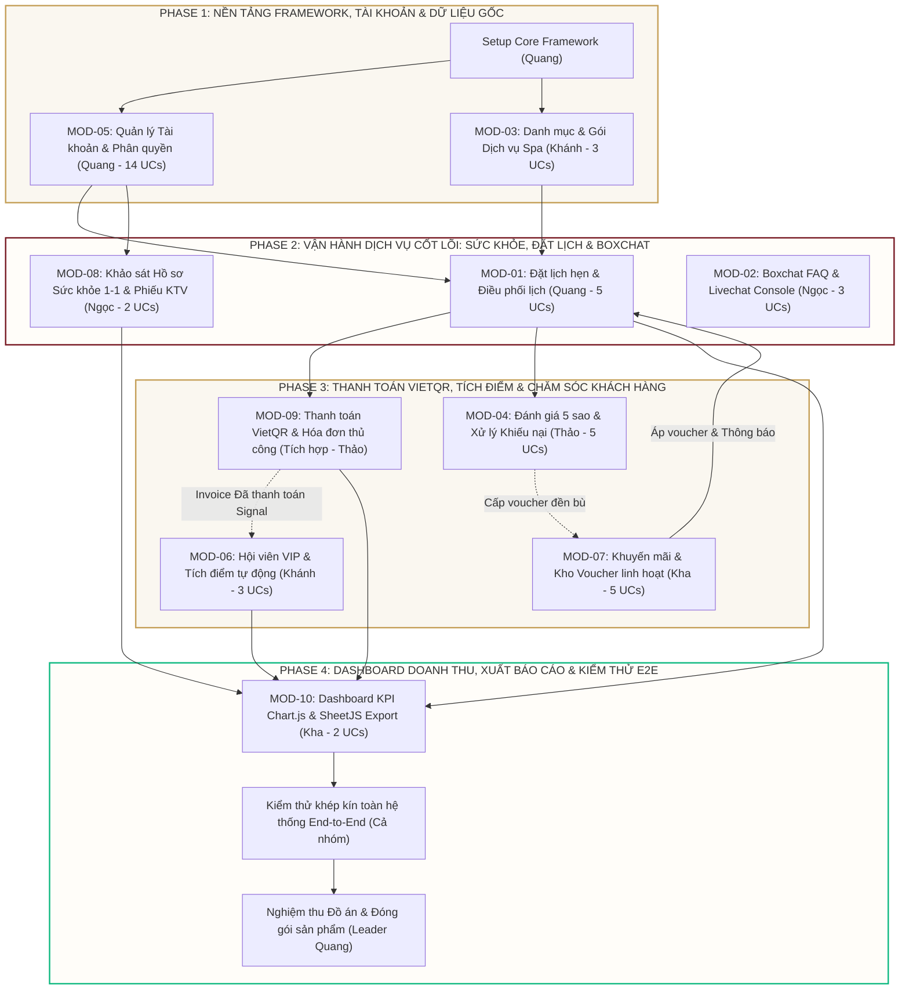

# HỆ THỐNG QUẢN LÝ QUAN HỆ KHÁCH HÀNG & ĐẶT LỊCH DỊCH VỤ SPA (CHAMSPA CRM)

[](https://www.python.org/)
[](https://www.djangoproject.com/)
[](https://getbootstrap.com/)
[](https://www.sqlite.org/)
[](https://vietqr.io/)
[](https://chamspa.pythonanywhere.com/)
[](#-v-chức-năng-chi-tiết-các-module-mod-01-đến-mod-10)

---

## 📌 I. THÔNG TIN CHUNG DỰ ÁN

* **Tên đề tài:** Hệ thống Quản lý Quan hệ Khách hàng & Đặt lịch dịch vụ Spa (**ChamSPA CRM**)
* **Đơn vị đào tạo:** Trường Đại học Kinh tế – Đại học Đà Nẵng (**DUE**) | **Học phần:** Lập trình Web
* **Giảng viên hướng dẫn:** **TS. Đặng Trung Thành**
* **Live Demo (Production):** [https://chamspa.pythonanywhere.com](https://chamspa.pythonanywhere.com)
* **Doanh nghiệp nghiên cứu:** **ChamSpa & Massage Đà Nẵng** (Massage trị liệu Đông y & Thư giãn chuyên sâu)
* **Địa chỉ cơ sở:** 05 Lê Quang Hoà, Hoà Xuân, Cẩm Lệ, TP. Đà Nẵng | **Hotline:** `0987 773 777` | **Giờ mở cửa:** `8:30 – 22:00`
* **Đội ngũ sinh viên thực hiện (5 thành viên) & Phân công phân hệ:**
  1. **Lê Nhật Quang (Leader):** Kiến trúc lõi (`core`), **MOD-01** (`appointment`), **MOD-05** (`accounts`)
  2. **Thảo Ngọc:** **MOD-02** (`chatbox`), **MOD-08** (`health`)
  3. **Minh Khánh:** **MOD-03** (`services`), **MOD-06** (`membership`)
  4. **Thanh Thảo:** **MOD-04** (`feedbacks`), **MOD-09** (Thanh toán VietQR & Hóa đơn — tích hợp trong `appointment`, `membership/signals.py` và `dashboard`)
  5. **Minh Kha:** **MOD-07** (`marketing`), **MOD-10** (`dashboard`)

---

## 🛠️ II. KIẾN TRÚC HỆ THỐNG & CÔNG NGHỆ

### 1. Công nghệ sử dụng (Tech Stack)

1. **Backend & Xử lý nghiệp vụ:** Python (`>= 3.10`, hỗ trợ Django `>= 5.1`, vận hành trên PythonAnywhere với Python `3.12` & Django `6.1.x`; các thư viện trong `requirements.txt`: `Django>=5.1`, `Pillow>=10.0.0`, `asgiref>=3.8.0`, `sqlparse>=0.5.0`). Tầng backend được chuẩn hóa theo mô hình **Django SSR Views/Forms** kết hợp **Pure Django JSON APIs (`JsonResponse` + helpers tại `core/ajax.py`)** gọn nhẹ và đồng nhất.
2. **Cơ sở dữ liệu (Database):** **SQLite** (`db.sqlite3`) — toàn bộ **20 model** của hệ thống được định nghĩa tập trung trong [`core/models.py`](core/models.py) và đăng ký quản trị tại [`core/admin.py`](core/admin.py). Ngôn ngữ `vi`, múi giờ `Asia/Ho_Chi_Minh`.
3. **Giao diện, Layout & SEO:**
   * **Django Templates** với 4 layout kế thừa theo vai trò (`public_layout.html`, `customer_layout.html`, `staff_layout.html`, `admin_layout.html`) và các sidebar/topbar chuyên biệt trong `templates/components/`.
   * **Bootstrap 5.3.3** & **Bootstrap Icons 1.11.3**, tùy biến bộ màu & typography Cham Spa tập trung tại [`static/css/chamspa.css`](static/css/chamspa.css).
   * **Google Fonts:** `Lora`, `Tinos` (tiêu đề serif) và `Cabin`, `Manrope` (nội dung).
   * **Open Graph & Twitter Cards (`templates/base.html`):** Cấu hình sẵn `og:title`, `og:description`, `og:image` (`hero_image.png`) để hiển thị ảnh xem trước đẹp khi chia sẻ link qua Zalo, Messenger, Facebook.
4. **Tương tác động & Thư viện Client (CDN):**
   * **Vanilla JavaScript (Fetch API):** Gọi JSON API bất đồng bộ để lọc dữ liệu, cập nhật trạng thái, chat polling, mở modal và render bảng biểu.
   * **Chart.js:** Vẽ **6 biểu đồ** phân tích doanh thu, dịch vụ, hội viên, trạng thái lịch và hồ sơ sức khỏe trên Dashboard Quản trị.
   * **SheetJS (`xlsx 0.18.5`) & `html2pdf.js 0.10.1`:** Xuất báo cáo Excel (`.xlsx` với 2 sheet `TongQuan_KPI` & `ChiTiet_HoaDon`) và PDF (`.pdf`) trực tiếp tại trình duyệt ở `admin_dashboard.html`.
   * **FullCalendar (`6.1.15`):** Đã nạp sẵn qua CDN trong `templates/base.html` làm nền mở rộng (giao diện đặt lịch & điều phối hiện sử dụng lưới chọn ngày/slot và bảng lọc tối ưu riêng).
   * **VietQR (`img.vietqr.io` / `api.vietqr.io`):** Sinh ảnh mã QR chuyển khoản theo số tiền và nội dung `CHAMSPA <MÃ_LỊCH>` (hiển thị hướng dẫn chuyển khoản; việc xác nhận & đổi trạng thái thanh toán được thực hiện thủ công bằng thao tác bấm nút, **không tích hợp webhook ngân hàng tự động**).
5. **Email, Middleware & Lưu trữ Media:**
   * **Email SMTP / Console (`config/settings.py`):** Đọc cấu hình từ `.env`; tự động dùng Gmail SMTP (`smtp.gmail.com:587` TLS) khi có `EMAIL_HOST_USER`/`EMAIL_HOST_PASSWORD` để gửi email đặt lại mật khẩu, hoặc fallback sang `console.EmailBackend` khi dev local.
   * `core.middleware.ChamSpaErrorFallbackMiddleware` điều hướng trang `404.html` / xử lý lỗi an toàn (bỏ qua các đường dẫn API).
   * Lưu ảnh đại diện (`media/avatars/`) và ảnh minh chứng đánh giá/khiếu nại (`media/feedbacks/YYYYMM/`) bằng `Pillow`.

### 2. Cấu trúc thư mục dự án

```text
CHAMSPA CRM/
├── config/                 # Cấu hình Django (settings.py, urls.py, wsgi.py, asgi.py)
├── core/                   # 20 Models CSDL tập trung, admin.py, ajax.py, middleware.py, views.py
├── accounts/               # MOD-05: Xác thực, hồ sơ cá nhân, quản lý Khách hàng 360 & Nhân viên
├── appointment/            # MOD-01 (+ VietQR MOD-09): Đặt lịch, Digital Pass, dời/hủy, điều phối & thanh toán
├── chatbox/                # MOD-02: Chatbot FAQ, Widget, Staff Livechat Console & Admin Monitor
├── services/               # MOD-03: Danh mục liệu trình, chi tiết dịch vụ & quản trị dịch vụ
├── feedbacks/              # MOD-04: Đánh giá 5 sao, khiếu nại có minh chứng & cấp voucher đền bù
├── membership/             # MOD-06: Thẻ hội viên 4 hạng, tra cứu tại quầy & Signal tích điểm tự động
├── marketing/              # MOD-07: Khuyến mãi, kho Voucher, chuông thông báo & broadcast
├── health/                 # MOD-08: Hồ sơ sức khỏe 1-1, BMI, cảnh báo y tế & phiếu KTV in ấn
├── dashboard/              # MOD-10: Staff Dashboard, Admin Dashboard 6 biểu đồ & Export Excel/PDF
├── templates/              # Giao diện HTML phân chia theo layouts/, components/ và từng app
├── static/                 # CSS hợp nhất (chamspa.css) & tài nguyên hình ảnh thương hiệu
├── media/                  # Thư mục lưu ảnh upload người dùng (avatars, feedbacks)
├── seed_demo_data.py       # Script reset và khởi tạo dữ liệu mẫu sạch cho toàn bộ 20 bảng
├── requirements.txt        # Danh sách thư viện Python phụ thuộc
├── .env                    # Biến môi trường cấu hình (DEBUG, SITE_URL, SMTP Gmail...)
├── db.sqlite3              # Cơ sở dữ liệu SQLite demo đi kèm
└── manage.py
```

---

## 🚀 III. HƯỚNG DẪN CÀI ĐẶT & TÀI KHOẢN DEMO

### 1. Cài đặt và chạy trên máy local

```bash
# 1. Tạo và kích hoạt môi trường ảo
python -m venv .venv

# Windows (PowerShell)
.venv\Scripts\Activate.ps1
# macOS / Linux
source .venv/bin/activate

# 2. Cài đặt thư viện phụ thuộc
pip install -r requirements.txt

# 3. Kiểm tra cấu hình & áp dụng migration (nếu dùng DB mới)
python manage.py check
python manage.py migrate

# 4. (Tùy chọn) Reset và nạp lại toàn bộ dữ liệu mẫu chuẩn
python seed_demo_data.py

# 5. Khởi chạy server phát triển
python manage.py runserver
```

Truy cập hệ thống tại `http://127.0.0.1:8000/`.

### 2. Tài khoản Demo mặc định

Hệ thống hỗ trợ đăng nhập linh hoạt bằng **Email**, **Số điện thoại** hoặc **Username**:

| Vai trò | Username / Email đăng nhập | Số điện thoại | Mật khẩu | Ghi chú |
| :--- | :--- | :--- | :--- | :--- |
| **Admin (`is_superuser`)** | `admin` / `admin@chamspa.vn` | `0886556303` | `admin123` | Mật khẩu trên `db.sqlite3` có sẵn (nếu khởi tạo DB mới hoàn toàn chưa có `admin`, `seed_demo_data.py` dùng `Admin@2026`). |
| **Staff (`is_staff`)** | `staff@chamspa.vn` | `0905123456` | `staff123` | Cùng 5 tài khoản nhân viên mẫu khác mang domain `@chamspa.vn`. |
| **Customer** | `customer@gmail.com` | `0912845660` | `customer123` | Cùng 5 tài khoản khách hàng mẫu khác mang domain `@gmail.com`. |

### 3. Hướng dẫn Deploy lên PythonAnywhere (Free Beginner Plan)

1. Mở **Consoles → Bash** trên PythonAnywhere, clone mã nguồn và cài đặt môi trường ảo:
   ```bash
   git clone https://github.com/nhatquanggle-maker/chamspacrm.git
   cd chamspacrm
   mkvirtualenv chamspa --python=python3.12
   pip install -r requirements.txt
   echo "" >> .env
   echo "SITE_URL=https://chamspa.pythonanywhere.com" >> .env
   echo "DEBUG=False" >> .env
   python manage.py collectstatic --noinput
   ```
2. Mở tab **Web → Add a new web app → Manual configuration → Python 3.12**, cấu hình:
   * **Source code & Working directory:** `/home/chamspa/chamspacrm`
   * **Virtualenv:** `/home/chamspa/.virtualenvs/chamspa`
   * **Static files:** `/static/` → `/home/chamspa/chamspacrm/staticfiles` và `/media/` → `/home/chamspa/chamspacrm/media`
   * **WSGI configuration file:** trỏ `sys.path` tới `/home/chamspa/chamspacrm` và `DJANGO_SETTINGS_MODULE = 'config.settings'`
   * Bật **Force HTTPS** và bấm **Reload**.

---

## 👥 IV. CƠ CHẾ PHÂN QUYỀN & QUY TẮC NGHIỆP VỤ CHUNG

Hệ thống sử dụng Custom User Model `core.User` (kế thừa `AbstractUser`, chuẩn hóa SĐT duy nhất, khóa mềm bằng `is_active`) cho **4 nhóm đối tượng**:

| Đối tượng | Điều kiện phân quyền | Phạm vi chức năng thực tế trong hệ thống |
| :--- | :--- | :--- |
| **Khách vãng lai** | Chưa đăng nhập | Xem Trang chủ (`/`), Danh sách & Chi tiết Dịch vụ (`/services/`), trò chuyện Chatbot FAQ trên Widget nổi / `/chatbox/customer/` (chạy stateless, **không lưu vào CSDL**; đặt lịch trực tuyến hoặc gặp nhân viên đều yêu cầu đăng nhập). |
| **Khách hàng (`Customer`)** | `is_authenticated=True`<br>`is_staff=False`<br>`is_superuser=False` | **Đối tượng duy nhất được đặt lịch trực tuyến** (`/appointment/booking/` & `/appointment/api/create/`). Xem Vé trải nghiệm Digital Pass, Lịch hẹn của tôi (dời/hủy lịch), bấm xác nhận thủ công đã chuyển khoản hoặc chọn trả tại quầy, cập nhật Hồ sơ Sức khỏe 1-1, xem Thẻ VIP & Ví Voucher, theo dõi Thông báo & Ưu đãi (`/marketing/`), gửi Đánh giá & Khiếu nại (cho lịch `Completed`), trò chuyện Livechat có lưu lịch sử CSDL. |
| **Nhân viên (`Staff`)** | `is_staff=True`<br>`is_superuser=False` | Làm việc trên **Staff Workspace** (`/dashboard/staff/`): tạo nhanh lịch tại quầy (`staff_quick_create_api`), cập nhật thủ công phương thức thanh toán & xác nhận thu tiền hóa đơn, trực **Livechat Console** & quản trị FAQ, tra cứu/tạo khách hàng từ **Hồ sơ Sức khỏe** + in **Phiếu KTV**, tra cứu & điều chỉnh điểm/hạng **Hội viên**, quản lý Danh mục Dịch vụ, duyệt/ẩn/trả lời Đánh giá, tiếp nhận & giải quyết Khiếu nại (trừ Phân công/Từ chối), xem Thông báo nội bộ & Khách hàng 360. *(Không hiển thị Widget Chat ở giao diện công khai).* |
| **Quản trị viên (`Admin`)** | `is_superuser=True` | Toàn quyền trên **Admin Workspace** (`/dashboard/admin/`): toàn bộ quyền vận hành của Staff cộng thêm các quyền độc quyền: xem **Admin Dashboard 6 biểu đồ & xuất Excel/PDF**, phát hành/xóa **Thông báo hàng loạt** (`marketing:admin_notifications`), CRUD **Khuyến mãi & Mã Voucher** (`marketing:admin_promotions`), **Phân công** & **Từ chối khiếu nại** (`MOD-04`), và truy cập `/admin/` (Django Admin). |

### Quy tắc đồng bộ & kiểm soát dữ liệu nổi bật

* **Phân tách đuôi Email theo vai trò (`accounts/forms.py`):** Khách hàng đăng ký/tạo mới bắt buộc dùng `@gmail.com`; nhân viên và quản trị viên nội bộ dùng `@chamspa.vn`.
* **Tự động khởi tạo dữ liệu liên kết (`accounts/signals.py`):** Ngay khi tạo tài khoản `User`, hệ thống tự sinh `UserProfile`; nếu là Khách hàng (`not is_staff and not is_superuser`), tự động cấp `Membership` (hạng thấp nhất `Hạng Đồng`), tạo `UserHealthProfile` (`HS-{id:04d}`) và gán quyền sở hữu các `Appointment` trước đó khớp số điện thoại.
* **Khóa mềm tài khoản (Soft Lock):** Thao tác khóa tài khoản chỉ chuyển `User.is_active = False`, không xóa vật lý bản ghi để bảo toàn toàn vẹn khóa ngoại lịch hẹn, hóa đơn và phản hồi.

---

## 📋 V. CHỨC NĂNG CHI TIẾT CÁC MODULE (MOD-01 ĐẾN MOD-10)

### 1. Lộ trình triển khai & Tích hợp liên Module (Phase 1 – Phase 4)



---

### 2. Bảng Ma trận 45 Use Cases toàn hệ thống (Use Case Matrix)

Hệ thống ChamSPA CRM được thiết kế và hiện thực hóa với quy mô **45 Use Cases nghiệp vụ chuyên sâu** (được chuẩn hóa đồng bộ 100% giữa file Đặc tả chức năng và mã nguồn thực tế), bao phủ trọn vẹn 10 phân hệ chức năng và 4 nhóm tác nhân (Khách vãng lai, Khách hàng thành viên, Nhân viên ca trực, Quản trị viên):

| STT | Mã UC | Tên Use Case nghiệp vụ | Phân hệ | Phụ trách | Tác nhân (Actor) | Tuyến URL / Endpoint kỹ thuật | Ghi chú & Ràng buộc mã nguồn thực tế | Trạng thái |
| :---: | :---: | :--- | :---: | :---: | :--- | :--- | :--- | :---: |
| **01** | `UC-1.1` | Đặt lịch hẹn trực tuyến | **MOD-01** | Quang | Khách hàng | `/appointment/booking/` | Wizard 3 bước, chọn chi nhánh/ngày/slot (tối đa 10 khách/slot/chi nhánh, khóa giờ quá khứ), chọn số lượng khách (Nam/Nữ), dịch vụ & lực massage (Nhẹ/Vừa/Mạnh), áp dụng voucher. Đã bỏ chọn KTV trên web. Tạo lịch ở trạng thái Hold/Pending và mở modal VietQR. | Hoàn thành |
| **02** | `UC-1.2` | Quản lý lịch cá nhân | **MOD-01** | Quang | Khách hàng | `/appointment/my-appointments/` | Xem lại toàn bộ lịch hẹn cá nhân (tự động đồng bộ thêm lịch trùng SĐT), chia 4 tab trực quan (Tất cả, Sắp tới, Hoàn thành, Đã hủy), theo dõi mã vé Digital Pass và trạng thái thời gian thực. | Hoàn thành |
| **03** | `UC-1.3` | Dời lịch hẹn | **MOD-01** | Quang | Khách hàng | `/appointment/api/<pk>/reschedule/` | Cho phép đổi ngày hẹn/khung giờ mới cho lịch ở trạng thái Hold, Pending, Confirmed. Kiểm tra khung giờ mới không vượt quá 10 khách và không ở quá khứ (đã linh hoạt bỏ ràng buộc 2 tiếng để thuận tiện kiểm thử demo). | Hoàn thành |
| **04** | `UC-1.4` | Hủy lịch hẹn | **MOD-01** | Quang | Khách hàng | `/appointment/api/<pk>/cancel/` | Hủy lịch hẹn đã đặt kèm nhập bắt buộc lý do hủy và số tài khoản ngân hàng để nhận hoàn tiền. Tự động giải phóng slot, chuyển Invoice sang 'Không hợp lệ' và hoàn lại Voucher khả dụng. | Hoàn thành |
| **05** | `UC-1.5` | Quản lý danh sách lịch hẹn | **MOD-01** | Quang | Nhân viên, Quản lý | /appointment/staff/, /appointment/admin/ | Điều phối lịch tại quầy lễ tân: tạo nhanh lịch cho khách walk-in (staff_quick_create_api), lọc theo ngày/slot/trạng thái, chuyển đổi 6 trạng thái vòng đời (Hold -> Pending -> Confirmed -> In_Progress -> Completed -> Cancelled) và xuất file CSV UTF-8-BOM. | Hoàn thành |
| **06** | `UC-2.1` | Trò chuyện với Chatbot tự động | **MOD-02** | Ngọc | Khách vãng lai, Khách hàng | `/chatbox/customer/` | Tương tác tự động với Bot qua Widget nổi hoặc trang chuyên biệt. Trả lời FAQ kịch bản thuần TEXT theo từ khóa (giờ mở cửa, giá dịch vụ, ưu đãi, vị trí). Khách vãng lai chạy stateless (không lưu DB); khách đăng nhập lưu CSDL bảng Conversation. | Hoàn thành |
| **07** | `UC-2.2` | Trò chuyện trực tiếp (Kết nối nhân viên tư vấn) | **MOD-02** | Ngọc | Khách hàng, Nhân viên CSKH, Quản lý | /chatbox/livechat/, /chatbox/admin/monitor/ | Khách hàng yêu cầu gặp tư vấn viên -> Chuyển phiên sang 'Đang chờ'. Nhân viên tiếp nhận tại Livechat Console, khóa phiên 1-1, gửi nhanh thẻ Dịch vụ/Voucher. Admin Monitor giám sát toàn bộ, hỗ trợ tiếp quản (takeover) hoặc điều chuyển (reassign). | Hoàn thành |
| **08** | `UC-2.3` | Quản lý kịch bản Chatbot (FAQ) | **MOD-02** | Ngọc | Quản lý | `/chatbox/admin/faqs/` | Quản lý danh sách câu hỏi thường gặp: thêm mới, chỉnh sửa, bật/tắt hiển thị (Active/Hidden), xóa và xuất kịch bản FAQ ra file CSV (/chatbox/api/admin/faqs/export/). | Hoàn thành |
| **09** | `UC-3.1` | Xem danh sách dịch vụ | **MOD-03** | Khánh | Khách vãng lai, Khách hàng | `/services/, /services/api/` | Hiển thị danh sách dịch vụ dạng lưới card phân trang (9 dịch vụ/trang), lọc theo danh mục hoạt động, tìm kiếm từ khóa, lọc khoảng giá và thời lượng (30-120 phút), sắp xếp giá/đánh giá. Đã bỏ bộ đếm lượt xem vào CSDL. | Hoàn thành |
| **10** | `UC-3.2` | Xem chi tiết dịch vụ | **MOD-03** | Khánh | Khách vãng lai, Khách hàng | `/services/detail/<slug>/` | Hiển thị thông tin chuyên sâu của dịch vụ: bộ sưu tập ảnh thực tế (ServiceImage), giá niêm yết, thời lượng, mô tả 4 bước liệu trình thư giãn, điểm đánh giá trung bình và các nhận xét hợp lệ từ khách hàng. | Hoàn thành |
| **11** | `UC-3.3` | Quản lý danh mục & dịch vụ | **MOD-03** | Khánh | Quản lý | `/services/admin/` | Không gian quản trị dịch vụ với 3 thẻ KPI (Tổng, Đang chạy, Tạm ẩn), tìm kiếm nhanh, modal thêm/sửa dịch vụ trong transaction, bật/tắt hoạt động và xóa mềm an toàn (tự chuyển 'Ngừng hoạt động' nếu dịch vụ đã có trong lịch hẹn). | Hoàn thành |
| **12** | `UC-4.1` | Gửi đánh giá / khiếu nại về dịch vụ | **MOD-04** | Thảo | Khách hàng | `/feedbacks/` | Dành riêng cho lịch hẹn trạng thái 'Completed'. Tab Đánh giá: chấm 1-5 sao, chọn tag cảm nhận, nhập nhận xét và tải tối đa 3 ảnh. Tab Khiếu nại: mô tả sự cố, yêu cầu mong muốn và đính kèm tối đa 3 ảnh minh chứng. | Hoàn thành |
| **13** | `UC-4.2` | Duyệt / Ẩn đánh giá | **MOD-04** | Thảo | Quản lý | `/feedbacks/admin/` | Quản trị viên lọc đánh giá theo số sao/trạng thái; kiểm duyệt nội dung và bấm nút Ẩn/Hiện đánh giá vi phạm (chuyển trạng thái 'Đã ẩn' để không hiển thị công khai trên trang dịch vụ). | Hoàn thành |
| **14** | `UC-4.3` | Phản hồi đánh giá của khách hàng | **MOD-04** | Thảo | Nhân viên, Quản lý | `/feedbacks/admin/` | Nhân viên hoặc Quản lý nhập câu trả lời công khai cho đánh giá của khách hàng. Hệ thống lưu nội dung reply, ID người phản hồi (replied_by_id) và thời gian (replied_at), hiển thị rõ tên nhân viên trên website. | Hoàn thành |
| **15** | `UC-4.4` | Xử lý khiếu nại dịch vụ | **MOD-04** | Thảo | Nhân viên CSKH, Quản lý | `/feedbacks/admin/` | Quy trình giải quyết khiếu nại 4 bước nghiêm ngặt: Tiếp nhận ca khiếu nại, Phân công nhân viên phụ trách (chỉ Admin), Từ chối khiếu nại (chỉ Admin), Giải quyết (Staff/Admin nhập resolution_note và tùy chọn tự động cấp Voucher đền bù DENBU-...). | Hoàn thành |
| **16** | `UC-4.5` | Theo dõi tiến độ khiếu nại | **MOD-04** | Thảo | Khách hàng, Nhân viên, Quản lý | `/feedbacks/, /feedbacks/admin/` | Khách hàng theo dõi trạng thái tiến trình xử lý tại tab Khiếu nại của tôi, xem ghi chú phản hồi từ Spa và nhận mã voucher đền bù; Quản lý/Nhân viên theo dõi tiến độ tổng thể của toàn bộ khiếu nại trong hệ thống. | Hoàn thành |
| **17** | `UC-5.1` | Đăng ký tài khoản | **MOD-05** | Quang | Khách vãng lai | `/accounts/register/` | Khách vãng lai đăng ký tài khoản thành viên mới: bắt buộc Số điện thoại duy nhất và Email chuẩn @gmail.com. Hệ thống tự động tạo User, UserProfile, cấp thẻ Membership (Hạng Đồng) và gán lịch hẹn cũ trùng SĐT. | Hoàn thành |
| **18** | `UC-5.2` | Đăng nhập hệ thống | **MOD-05** | Quang | Tất cả vai trò | `/accounts/login/` | Đăng nhập linh hoạt bằng Email, Số điện thoại hoặc Username. Kiểm tra tài khoản is_active (chặn đăng nhập nếu bị khóa mềm) và tự động điều hướng đúng vai trò (Customer -> Trang chủ, Staff -> Staff Workspace, Admin -> Admin Dashboard). | Hoàn thành |
| **19** | `UC-5.3` | Quên / Đặt lại mật khẩu | **MOD-05** | Quang | Tất cả vai trò | `/accounts/forgot-password/` | Khôi phục mật khẩu thông qua PasswordResetTokenGenerator. Hệ thống tạo token an toàn và hiển thị link đặt lại trực tiếp trên giao diện để thuận tiện kiểm thử demo không cần cấu hình SMTP ngoài. | Hoàn thành |
| **20** | `UC-5.4` | Quản lý hồ sơ cá nhân | **MOD-05** | Quang | Tất cả vai trò đã đăng nhập | `/accounts/profile/` | Kế thừa layout động theo vai trò (Customer, Staff, Admin). Cập nhật Họ tên, SĐT (kiểm tra không trùng), Ngày sinh, Giới tính, tải lên Avatar đại diện và đổi mật khẩu tài khoản. | Hoàn thành |
| **21** | `UC-5.5` | Đăng xuất tài khoản | **MOD-05** | Quang | Tất cả vai trò đã đăng nhập | `/accounts/logout/` | Xử lý hủy phiên làm việc qua HTTP POST có kèm CSRF token bảo mật. Xóa sạch session và điều hướng người dùng về Trang chủ an toàn. | Hoàn thành |
| **22** | `UC-5.6` | Quản lý danh sách tài khoản User | **MOD-05** | Quang | Quản lý | /accounts/admin/customers/, /accounts/admin/staff/ | Quản trị viên theo dõi toàn bộ tài khoản người dùng trong hệ thống (Khách hàng và Nhân viên), hỗ trợ tìm kiếm đa trường (Tên, SĐT, Email), lọc vai trò và phân trang rõ ràng. | Hoàn thành |
| **23** | `UC-5.7` | Mở / Khóa tài khoản người dùng | **MOD-05** | Quang | Quản lý | /accounts/admin/customers/<pk>/toggle/, /accounts/admin/staff/<pk>/toggle/ | Quản lý thực hiện khóa/mở khóa tài khoản thông qua cờ User.is_active (khóa mềm). Tài khoản bị khóa mất quyền đăng nhập ngay lập tức nhưng toàn bộ dữ liệu lịch sử lịch hẹn, hóa đơn được bảo toàn trọn vẹn. | Hoàn thành |
| **24** | `UC-5.8` | Xem thông tin khách hàng | **MOD-05** | Quang | Nhân viên, Quản lý | `/accounts/admin/customers/<pk>/` | Màn hình Khách hàng 360 với 3 tab: (1) Thông tin cá nhân & Liên hệ, (2) Hồ sơ Sức khỏe & Thể trạng, (3) Thẻ Hội viên, Điểm thưởng, Lịch sử đặt lịch và Phản hồi dịch vụ. | Hoàn thành |
| **25** | `UC-5.9` | Cập nhật thông tin khách hàng | **MOD-05** | Quang | Nhân viên, Quản lý | `/accounts/admin/customers/<pk>/edit/` | Nhân viên lễ tân hoặc Quản lý hỗ trợ chỉnh sửa thông tin cá nhân (Họ tên, SĐT, Ngày sinh, Giới tính) cho khách hàng trực tiếp tại quầy theo yêu cầu. | Hoàn thành |
| **26** | `UC-5.10` | Khóa tài khoản khách hàng | **MOD-05** | Quang | Quản lý | `/accounts/admin/customers/<pk>/toggle/` | Vô hiệu hóa tài khoản khách hàng vi phạm bằng cơ chế soft lock (is_active=False) thay vì xóa vật lý, đảm bảo toàn vẹn dữ liệu cho các phân hệ lịch hẹn và doanh thu. | Hoàn thành |
| **27** | `UC-5.11` | Tạo tài khoản nhân viên mới | **MOD-05** | Quang | Quản lý | `/accounts/admin/staff/add/` | Quản trị viên tạo tài khoản nhân sự mới: bắt buộc sử dụng email nội bộ tên miền @chamspa.vn, tự động thiết lập quyền is_staff=True, is_superuser=False và khởi tạo UserProfile. | Hoàn thành |
| **28** | `UC-5.12` | Xem danh sách nhân viên | **MOD-05** | Quang | Quản lý | `/accounts/admin/staff/` | Quản lý theo dõi danh sách toàn bộ nhân viên trong Spa (User.is_staff=True), phân trang 7 nhân viên/trang, hiển thị trạng thái làm việc, ngày gia nhập và thông tin liên hệ. | Hoàn thành |
| **29** | `UC-5.13` | Cập nhật thông tin nhân viên | **MOD-05** | Quang | Quản lý | `/accounts/admin/staff/<pk>/edit/` | Quản lý chỉnh sửa thông tin nhân sự (Họ tên, SĐT) và hỗ trợ cấp lại mật khẩu khởi tạo mới cho nhân viên khi quên mật khẩu. | Hoàn thành |
| **30** | `UC-5.14` | Khóa tài khoản nhân viên | **MOD-05** | Quang | Quản lý | `/accounts/admin/staff/<pk>/toggle/` | Quản lý khóa tài khoản nhân viên khi nghỉ việc (chuyển is_active=False). Cơ chế kiểm tra an toàn chặn tuyệt đối Quản trị viên tự khóa tài khoản của chính mình. | Hoàn thành |
| **31** | `UC-6.1` | Xem thông tin hội viên & Tiến trình thăng hạng | **MOD-06** | Khánh | Khách hàng | `/membership/` | Hiển thị Thẻ điện tử Serenity VIP Pass với 4 thứ hạng (Đồng 0%, Bạc 5%, Vàng 10%, Kim Cương 15%), điểm hiện tại, tổng chi tiêu, thanh tiến trình thăng hạng và bảng lịch sử biến động điểm thưởng (10 dòng/trang). | Hoàn thành |
| **32** | `UC-6.2` | Tra cứu thông tin hội viên | **MOD-06** | Khánh | Nhân viên, Quản lý | /membership/staff/, /membership/api/lookup/ | Nhân viên tra cứu nhanh hồ sơ hội viên qua SĐT tại quầy để áp dụng chiết khấu đặc quyền, xem KPI tổng hội viên, hỗ trợ bàn cộng/trừ điểm thủ công và điều chỉnh hạng thẻ trực tiếp. | Hoàn thành |
| **33** | `UC-6.3` | Tự động tích điểm & Thăng hạng hội viên | **MOD-06** | Khánh | Hệ thống tự động | `membership/signals.py` | Django Signal kích hoạt khi Invoice chuyển sang 'Đã thanh toán': tự động tính điểm theo tỷ lệ 10.000 VNĐ = 1 điểm, chống cộng trùng mã hóa đơn, cộng dồn current_points & total_spent, tự thăng hạng thẻ và gửi thông báo chúc mừng. | Hoàn thành |
| **34** | `UC-7.1` | Xem danh sách thông báo | **MOD-07** | Kha | Tất cả vai trò đã đăng nhập | /marketing/notifications/, /marketing/api/notifications/dropdown/ | Biểu tượng chuông trên thanh menu hiển thị dropdown 8 thông báo mới nhất lọc theo vai trò; trang bảng tin timeline hiển thị danh sách thông báo đầy đủ kèm bộ lọc phân loại và tìm kiếm. | Hoàn thành |
| **35** | `UC-7.2` | Xem danh sách ưu đãi & Kho Voucher | **MOD-07** | Kha | Khách hàng | `/marketing/` | Trang Ưu đãi gồm 2 tab: Tab Chương trình Khuyến mãi (dạng thẻ CSS card màu gradient) và Tab Ví Voucher cá nhân (tra cứu mã khả dụng, hạn dùng, sao chép mã và chuyển sang đặt lịch). | Hoàn thành |
| **36** | `UC-7.3` | Quản lý thông báo hệ thống | **MOD-07** | Kha | Nhân viên, Quản lý | /marketing/admin/notifications/, /marketing/staff/ | Nhân viên theo dõi thông báo ca trực; Quản trị viên soạn thảo, gửi thông báo đơn lẻ hoặc phát thông báo hàng loạt (bulk_create) đến toàn bộ khách hàng, nhân viên hoặc toàn hệ thống. | Hoàn thành |
| **37** | `UC-7.4` | Quản lý chương trình khuyến mãi & Mã Voucher | **MOD-07** | Kha | Quản lý | `/marketing/admin/promotions/` | Quản lý tạo mới, cập nhật hoặc đóng các chương trình khuyến mãi (Promotion); phát hành mã giảm giá Voucher linh hoạt theo % (có trần max_discount_amount) hoặc tiền mặt (FIXED) kèm đơn tối thiểu và hạn dùng. | Hoàn thành |
| **38** | `UC-7.5` | Tự động gửi thông báo hệ thống | **MOD-07** | Kha | Hệ thống tự động | `Django Signals nội bộ` | Hệ thống tự động sinh và lưu bản ghi Notification khi có sự kiện phát sinh: Đặt lịch thành công, Xác nhận thanh toán hóa đơn, Kết quả xử lý khiếu nại, Nâng hạng hội viên VIP. | Hoàn thành |
| **39** | `UC-8.1` | Cập nhật hồ sơ sức khỏe khách hàng | **MOD-08** | Ngọc | Khách hàng | `/health/update/` | Khảo sát thể trạng cá nhân theo quan hệ 1-1 tối giản (bản ghi mới ghi đè bản ghi cũ): chiều cao, cân nặng (tự động tính BMI), body map SVG chọn vùng đau, mức độ đau 1-10, huyết áp, lực massage ưu tiên, bệnh lý nền và dị ứng tinh dầu. | Hoàn thành |
| **40** | `UC-8.2` | Xem hồ sơ sức khỏe cá nhân (Tối giản 1-1) | **MOD-08** | Ngọc | Khách hàng, Nhân viên, Quản lý | `/health/, /health/staff/<user_id>/` | Khách hàng xem lại hồ sơ sức khỏe cá nhân; Nhân viên lễ tân/CSKH tra cứu hồ sơ khách, hệ thống tự động phân tích cảnh báo an toàn y tế (thai kỳ, tim mạch, huyết áp...) và hỗ trợ xuất/in Phiếu Kỹ thuật viên (KTV) trước ca trị liệu. | Hoàn thành |
| **41** | `UC-9.1` | Thanh toán chuyển khoản VietQR (Xác nhận thủ công) | **MOD-09** | Thảo | Khách hàng | Modal VietQR / /appointment/api/<pk>/confirm-payment/ | Hệ thống sinh mã QR VietQR động/tĩnh theo số tiền thực thu sau khi áp voucher và cú pháp 'CHAMSPA <MÃ_LỊCH>'. Hệ thống KHÔNG sử dụng webhook ngân hàng tự động; Khách hàng quét mã qua app ngân hàng và bấm nút xác nhận thủ công ('Tôi đã chuyển khoản thành công') hoặc chọn trả tại quầy. | Hoàn thành |
| **42** | `UC-9.2` | Đối soát & Cập nhật thanh toán tại quầy (Thủ công) | **MOD-09** | Thảo | Nhân viên Kế toán / Thu ngân, Quản lý | `/appointment/api/<pk>/update-payment/` | Thao tác thu ngân quầy: nhân viên đối chiếu sao kê ngân hàng hoặc thu tiền mặt, thực hiện chuyển đổi phương thức thanh toán và bấm nút xác nhận thu tiền thủ công để chuyển Invoice sang 'Đã thanh toán', từ đó kích hoạt Signal tích điểm hội viên. | Hoàn thành |
| **43** | `UC-9.3` | Theo dõi & Tra cứu danh sách hóa đơn | **MOD-09** | Thảo | Khách hàng, Nhân viên, Quản lý | /appointment/my-appointments/, /appointment/staff/, /dashboard/admin/ | Khách hàng xem lại lịch sử hóa đơn cá nhân gắn với lịch hẹn; Nhân viên và Quản lý theo dõi, tra cứu toàn bộ hóa đơn thanh toán trong hệ thống, xem bảng kê chi tiết dịch vụ và in biên lai thu tiền. | Hoàn thành |
| **44** | `UC-10.1` | Xem Dashboard thống kê tổng quan | **MOD-10** | Kha | Quản lý / Ban Giám đốc, Nhân viên | `/dashboard/admin/, /dashboard/staff/` | Hiển thị 4 thẻ KPI tăng trưởng thời gian thực (doanh thu, khách hàng, tỷ lệ hoàn thành, hội viên mới), 6 biểu đồ Chart.js chuyên sâu trên Admin Dashboard và Staff Dashboard ca trực phục vụ điều hành kinh doanh. | Hoàn thành |
| **45** | `UC-10.2` | Xuất báo cáo trực tiếp tại trình duyệt (Client-side Export) | **MOD-10** | Kha | Quản lý | `/dashboard/admin/` | Xuất báo cáo trực tiếp tại trình duyệt bằng JavaScript: file Excel đa sheet (SheetJS xlsx gồm sheet KPI & Hóa đơn chi tiết) và file PDF (html2pdf.js). Xử lý thuần phía Client, hoàn toàn loại bỏ bảng Report_export trên server. | Hoàn thành |

---

### 3. Chi tiết chức năng 10 phân hệ nghiệp vụ (MOD-01 đến MOD-10)

#### ✅ MOD-01: Đặt lịch & Quản lý Lịch hẹn (`appointment`) *(5 Use Cases: UC-1.1 -> UC-1.5)*
* **UC-1.1 - Đặt lịch hẹn trực tuyến (`/appointment/booking/` & `/appointment/api/create/`):** Giao diện Wizard 3 bước (Customer-only) cho phép chọn chi nhánh, ngày & khung giờ còn trống (giới hạn **tối đa 10 khách/khung giờ/ngày/chi nhánh** và tự khóa các khung giờ đã qua so với giờ hiện tại), cấu hình số lượng khách (Nam/Nữ), chọn dịch vụ & lực massage từng người (`Nhẹ`, `Vừa`, `Mạnh`), kiểm tra & áp dụng Voucher (`/appointment/api/apply-voucher/`). Đã loại bỏ hoàn toàn tính năng chọn KTV trên web (do quầy lễ tân điều phối). Tạo lịch hẹn thành công lưu bản ghi `Appointment` (`Hold`), `AppointmentDetail`, `Invoice` (`Chờ xác nhận`) và mở modal VietQR để khách quét mã chuyển khoản.
* **UC-1.2 - Quản lý lịch cá nhân (`/appointment/my-appointments/`):** Tự động đồng bộ thêm lịch hẹn trùng SĐT tài khoản; chia **4 tab** (`Tất cả`, `Sắp tới`, `Đã hoàn thành`, `Đã hủy`). Khách hàng theo dõi chi tiết lịch, xem vé trải nghiệm Digital Pass (`/appointment/success/<appointment_code>/`) và trạng thái thời gian thực.
* **UC-1.3 - Dời lịch hẹn (`/appointment/api/<pk>/reschedule/`):** Cho phép khách hàng dời ngày hoặc khung giờ sang thời điểm mới đối với các lịch ở trạng thái `Hold`, `Pending`, `Confirmed`; kiểm tra ngày/giờ mới không ở quá khứ và slot mới không vượt quá 10 khách *(đã lược bỏ quy tắc giới hạn >= 2 tiếng so với đặc tả cũ để linh hoạt trải nghiệm demo)*.
* **UC-1.4 - Hủy lịch hẹn (`/appointment/api/<pk>/cancel/`):** Cho phép hủy lịch hẹn đã đặt, bắt buộc nhập lý do hủy (`cancel_reason`) và số tài khoản ngân hàng nhận tiền hoàn (`refund_account_number`); tự động giải phóng chỗ, cập nhật `Invoice` sang `Không hợp lệ` và hoàn lại `Voucher` về trạng thái `Khả dụng`.
* **UC-1.5 - Quản lý danh sách lịch hẹn (`/appointment/staff/`, `/appointment/admin/`):** Dành cho Staff và Admin điều phối tại quầy: tạo nhanh lịch cho khách walk-in (`/appointment/api/staff/quick-create/`), lọc theo ngày/khung giờ/trạng thái/từ khóa, chuyển đổi vòng đời 6 trạng thái (`Hold` -> `Pending` -> `Confirmed` -> `In_Progress` -> `Completed` -> `Cancelled`), cập nhật hình thức thanh toán và xuất file **CSV UTF-8-BOM** danh sách lịch hẹn (`/appointment/admin/export/`).

#### ✅ MOD-02: Boxchat Tư vấn & Quản lý FAQ (`chatbox`) *(3 Use Cases: UC-2.1 -> UC-2.3)*
* **UC-2.1 - Trò chuyện với Chatbot tự động (`/chatbox/customer/`):** Tương tác với Bot FAQ qua Widget nổi hoặc trang chuyên biệt. Trả lời tự động các nhóm câu hỏi thường gặp (giờ hoạt động, bảng giá, chi nhánh, liệu trình lá thuốc) theo kịch bản thuần TEXT. Khách vãng lai trò chuyện hoàn toàn **stateless** (không lưu DB); khách hàng đăng nhập được lưu phiên `Conversation` và nạp lại lịch sử tin nhắn.
* **UC-2.2 - Trò chuyện trực tiếp / Kết nối nhân viên tư vấn (`/chatbox/livechat/`, `/chatbox/admin/monitor/`):** Khách hàng bấm yêu cầu gặp nhân viên tư vấn -> Chuyển phiên chat sang trạng thái `Đang chờ`. Nhân viên tiếp nhận tại **Staff Livechat Console**, hệ thống khóa phiên 1-1, cho phép gửi nhanh thẻ **Dịch vụ** và **Voucher** ngay trong khung chat. **Admin Livechat Monitor** giám sát 3 tab (`Chờ tiếp nhận`, `Đang xử lý`, `Đã đóng`), hỗ trợ điều chuyển (`reassign`) hoặc tiếp quản (`takeover`).
* **UC-2.3 - Quản lý kịch bản Chatbot (FAQ) (`/chatbox/admin/faqs/`):** Quản trị viên thêm mới, chỉnh sửa, bật/tắt `Active`/`Hidden`, xóa các câu hỏi FAQ thuần văn bản và xuất toàn bộ kịch bản hỏi đáp ra file **CSV** (`/chatbox/api/admin/faqs/export/`).

#### ✅ MOD-03: Quản lý Danh mục & Dịch vụ (`services`) *(3 Use Cases: UC-3.1 -> UC-3.3)*
* **UC-3.1 - Xem danh sách dịch vụ (`/services/` & `GET /services/api/`):** Lưới thẻ dịch vụ phân trang (9 dịch vụ/trang), hỗ trợ lọc đa tiêu chí theo danh mục hoạt động, tìm kiếm từ khóa, khoảng giá và các mốc thời lượng liệu trình (`30`, `45`, `60`, `75`, `90`, `120` phút), sắp xếp theo giá hoặc đánh giá sao. Đã bỏ bộ đếm lượt xem vào CSDL.
* **UC-3.2 - Xem chi tiết dịch vụ (`/services/detail/<slug>/`):** Cung cấp thông tin chuyên sâu của gói dịch vụ: bộ sưu tập ảnh thực tế (`ServiceImage`), giá niêm yết, thời lượng, mô tả 4 bước quy trình trị liệu chuẩn spa, điểm đánh giá trung bình và các nhận xét hợp lệ từ khách hàng.
* **UC-3.3 - Quản lý danh mục & dịch vụ (`/services/admin/`):** Bàn làm việc quản trị dịch vụ với 3 thẻ KPI (Tổng, Đang chạy, Tạm ẩn), tìm kiếm nhanh, modal thêm/sửa dịch vụ trong transaction, bật/tắt hoạt động (`toggle_service`) và xóa mềm an toàn (`delete_service` — tự chuyển `Ngừng hoạt động` nếu dịch vụ đã từng phát sinh trong `AppointmentDetail`).

#### ✅ MOD-04: Quản lý Đánh giá & Khiếu nại (`feedbacks`) *(5 Use Cases: UC-4.1 -> UC-4.5)*
* **UC-4.1 - Gửi đánh giá / khiếu nại về dịch vụ (`/feedbacks/`):** Dành riêng cho khách hàng có lịch hẹn đã `Completed`. Gồm 2 tab: Tab Đánh giá (chấm 1–5 sao, chọn thẻ tag cảm nhận, nhận xét chi tiết, tải tối đa 3 ảnh trải nghiệm); Tab Khiếu nại (mô tả sự cố, yêu cầu mong muốn, tải tối đa 3 ảnh/video bằng chứng minh họa).
* **UC-4.2 - Duyệt / Ẩn đánh giá (`/feedbacks/admin/`):** Quản lý theo dõi danh sách toàn bộ đánh giá, lọc theo số sao/trạng thái và bấm nút Ẩn/Hiện đánh giá vi phạm (chuyển sang `Đã ẩn` để không xuất hiện trên website khách hàng).
* **UC-4.3 - Phản hồi đánh giá của khách hàng (`/feedbacks/admin/`):** Nhân viên hoặc Quản lý gửi câu trả lời công khai cho đánh giá của khách hàng. Hệ thống lưu nội dung phản hồi, định danh `replied_by_id`, thời gian `replied_at` và hiển thị rõ tên nhân viên trên website.
* **UC-4.4 - Xử lý khiếu nại dịch vụ (`/feedbacks/admin/`):** Quy trình giải quyết khiếu nại 4 bước rõ ràng: Tiếp nhận ca khiếu nại (`take_complaint`), Phân công nhân viên xử lý (chỉ Quản lý `is_superuser`), Từ chối khiếu nại (chỉ Quản lý), và Giải quyết (`resolve_complaint` với ô ghi chú `resolution_note` kèm tùy chọn cấp tự động mã Voucher đền bù `DENBU-...` liên kết trực tiếp).
* **UC-4.5 - Theo dõi tiến độ khiếu nại (`/feedbacks/`, `/feedbacks/admin/`):** Khách hàng theo dõi trạng thái tiến trình xử lý tại tab Khiếu nại của tôi, xem ghi chú phản hồi từ Spa và nhận mã voucher đền bù; Quản lý/Nhân viên theo dõi tiến độ tổng thể của toàn bộ khiếu nại trong hệ thống.

#### ✅ MOD-05: Quản lý Tài khoản, Nhân sự & Khách hàng (`accounts`) *(14 Use Cases: UC-5.1 -> UC-5.14)*
* **UC-5.1 - Đăng ký tài khoản (`/accounts/register/`):** Khách vãng lai đăng ký tài khoản thành viên mới: kiểm tra số điện thoại duy nhất, bắt buộc sử dụng email tên miền `@gmail.com`. Tự động tạo `User`, `UserProfile`, cấp thẻ `Membership` (Hạng Đồng) và gán quyền sở hữu các lịch hẹn cũ trùng SĐT.
* **UC-5.2 - Đăng nhập hệ thống (`/accounts/login/`):** Hỗ trợ đăng nhập đa năng bằng Email, Số điện thoại hoặc Username. Kiểm tra cờ `is_active` (chặn đăng nhập nếu bị khóa mềm) và tự động điều hướng theo 4 nhóm vai trò (Customer -> Trang chủ, Staff -> Staff Workspace, Admin -> Admin Dashboard).
* **UC-5.3 - Quên / Đặt lại mật khẩu (`/accounts/forgot-password/`):** Thiết lập lại mật khẩu an toàn qua `PasswordResetTokenGenerator`, sinh link đặt lại mật khẩu và hiển thị trực tiếp trên giao diện để thuận tiện kiểm thử không cần dịch vụ gửi mail ngoài.
* **UC-5.4 - Quản lý hồ sơ cá nhân (`/accounts/profile/`):** Kế thừa layout động theo vai trò; cho phép xem và cập nhật Họ tên, Số điện thoại (kiểm tra không trùng), Ngày sinh, Giới tính, tải lên Avatar (`media/avatars/`) và đổi mật khẩu tài khoản.
* **UC-5.5 - Đăng xuất tài khoản (`/accounts/logout/`):** Hủy phiên làm việc người dùng thông qua phương thức HTTP POST có kiểm tra CSRF token bảo mật, xóa session và chuyển hướng an toàn về Trang chủ.
* **UC-5.6 - Quản lý danh sách tài khoản User (`/accounts/admin/customers/`, `/accounts/admin/staff/`):** Quản trị viên theo dõi toàn bộ tài khoản người dùng trong hệ thống (Khách hàng và Nhân viên), hỗ trợ tìm kiếm đa trường (Tên, SĐT, Email), lọc vai trò và phân trang rõ ràng.
* **UC-5.7 - Mở / Khóa tài khoản người dùng (`/accounts/admin/customers/<pk>/toggle/`, `/accounts/admin/staff/<pk>/toggle/`):** Quản lý thực hiện khóa/mở khóa tài khoản thông qua cờ `User.is_active` (khóa mềm). Tài khoản bị khóa mất quyền đăng nhập ngay lập tức nhưng toàn bộ dữ liệu lịch sử lịch hẹn, hóa đơn được bảo toàn trọn vẹn.
* **UC-5.8 - Xem thông tin khách hàng (`/accounts/admin/customers/<pk>/`):** Màn hình Khách hàng 360 với 3 tab: (1) Thông tin cá nhân & Liên hệ, (2) Hồ sơ Sức khỏe & Thể trạng, (3) Thẻ Hội viên, Điểm thưởng, Lịch sử đặt lịch và Phản hồi dịch vụ.
* **UC-5.9 - Cập nhật thông tin khách hàng (`/accounts/admin/customers/<pk>/edit/`):** Nhân viên lễ tân hoặc Quản lý hỗ trợ chỉnh sửa thông tin cá nhân (Họ tên, SĐT, Ngày sinh, Giới tính) cho khách hàng trực tiếp tại quầy theo yêu cầu.
* **UC-5.10 - Khóa tài khoản khách hàng (`/accounts/admin/customers/<pk>/toggle/`):** Vô hiệu hóa tài khoản khách hàng vi phạm bằng cơ chế soft lock (`is_active=False`) thay vì xóa vật lý, đảm bảo toàn vẹn dữ liệu cho các phân hệ lịch hẹn và doanh thu.
* **UC-5.11 - Tạo tài khoản nhân viên mới (`/accounts/admin/staff/add/`):** Quản trị viên tạo tài khoản nhân sự mới: bắt buộc sử dụng email nội bộ tên miền `@chamspa.vn`, tự động thiết lập quyền `is_staff=True`, `is_superuser=False` và khởi tạo `UserProfile`.
* **UC-5.12 - Xem danh sách nhân viên (`/accounts/admin/staff/`):** Quản lý theo dõi danh sách toàn bộ nhân viên trong Spa (`User.is_staff=True`), phân trang 7 nhân viên/trang, hiển thị trạng thái làm việc, ngày gia nhập và thông tin liên hệ.
* **UC-5.13 - Cập nhật thông tin nhân viên (`/accounts/admin/staff/<pk>/edit/`):** Quản lý chỉnh sửa thông tin nhân sự (Họ tên, SĐT) và hỗ trợ cấp lại mật khẩu khởi tạo mới cho nhân viên khi quên mật khẩu.
* **UC-5.14 - Khóa tài khoản nhân viên (`/accounts/admin/staff/<pk>/toggle/`):** Quản lý khóa tài khoản nhân viên khi nghỉ việc (chuyển `is_active=False`). Cơ chế kiểm tra an toàn chặn tuyệt đối Quản trị viên tự khóa tài khoản của chính mình.

#### ✅ MOD-06: Quản lý Hội viên VIP & Tích điểm (`membership`) *(3 Use Cases: UC-6.1 -> UC-6.3)*
* **UC-6.1 - Xem thông tin hội viên & Tiến trình thăng hạng (`/membership/`):** Khách hàng xem Thẻ điện tử *Serenity VIP Pass* với 4 thứ hạng (`Hạng Đồng` 0%, `Hạng Bạc` 5%, `Hạng Vàng` 10%, `Hạng Kim Cương` 15%), điểm hiện tại, tổng chi tiêu tích lũy, thanh tiến trình thăng hạng và bảng lịch sử biến động điểm thưởng (10 dòng/trang).
* **UC-6.2 - Tra cứu thông tin hội viên (`/membership/staff/` & `GET /membership/api/lookup/`):** Nhân viên tra cứu nhanh hồ sơ hội viên qua SĐT tại quầy để áp dụng chiết khấu đặc quyền, xem KPI tổng hội viên, hỗ trợ bàn cộng/trừ điểm thủ công và điều chỉnh hạng thẻ trực tiếp.
* **UC-6.3 - Tự động tích điểm & Thăng hạng hội viên (`membership/signals.py`):** Django Signal kích hoạt khi `Invoice` chuyển sang `Đã thanh toán`: tự động tính điểm theo tỷ lệ **10.000 VNĐ = 1 điểm**, chống cộng trùng theo mã hóa đơn, cập nhật `current_points` & `total_spent`, tự động thăng hạng thẻ khi đạt mốc và gửi thông báo chúc mừng.

#### ✅ MOD-07: Quản lý Thông báo & Khuyến mãi (`marketing`) *(5 Use Cases: UC-7.1 -> UC-7.5)*
* **UC-7.1 - Xem danh sách thông báo (`/marketing/notifications/` & `/marketing/api/notifications/dropdown/`):** Biểu tượng chuông trên thanh menu hiển thị dropdown 8 thông báo mới nhất lọc đúng theo vai trò; trang bảng tin timeline hiển thị danh sách thông báo đầy đủ kèm bộ lọc phân loại và tìm kiếm.
* **UC-7.2 - Xem danh sách ưu đãi & Kho Voucher (`/marketing/`):** Trang Ưu đãi gồm 2 tab: Tab Chương trình Khuyến mãi (dạng thẻ CSS card màu gradient tự cập nhật trạng thái) và Tab Ví Voucher cá nhân (tra cứu mã khả dụng, hạn dùng, sao chép mã và chuyển sang đặt lịch).
* **UC-7.3 - Quản lý thông báo hệ thống (`/marketing/admin/notifications/`, `/marketing/staff/`):** Nhân viên theo dõi thông báo ca trực; Quản trị viên soạn thảo, gửi thông báo đơn lẻ hoặc phát thông báo hàng loạt (`bulk_create`) đến toàn bộ khách hàng, nhân viên hoặc toàn hệ thống.
* **UC-7.4 - Quản lý chương trình khuyến mãi & Mã Voucher (`/marketing/admin/promotions/`):** Quản lý tạo mới, cập nhật hoặc đóng các chương trình khuyến mãi (`Promotion`); phát hành mã giảm giá Voucher linh hoạt theo % (có trần `max_discount_amount`) hoặc tiền mặt (`FIXED`) kèm đơn tối thiểu và hạn dùng.
* **UC-7.5 - Tự động gửi thông báo hệ thống (`Django Signals` nội bộ):** Hệ thống tự động sinh và lưu bản ghi `Notification` khi có sự kiện phát sinh: Đặt lịch thành công, Xác nhận thanh toán hóa đơn, Kết quả xử lý khiếu nại, Nâng hạng hội viên VIP.

#### ✅ MOD-08: Quản lý Hồ sơ Sức khỏe 1-1 (`health`) *(2 Use Cases: UC-8.1 -> UC-8.2)*
* **UC-8.1 - Cập nhật hồ sơ sức khỏe khách hàng (`/health/update/`):** Khách hàng khảo sát thể trạng cá nhân theo quan hệ 1-1 tối giản (bản ghi mới ghi đè bản ghi cũ): chiều cao, cân nặng (tự động tính BMI), body map SVG chọn vùng đau mỏi, mức độ đau 1-10, huyết áp, lực massage ưu tiên, bệnh lý nền và dị ứng tinh dầu.
* **UC-8.2 - Xem hồ sơ sức khỏe cá nhân (Tối giản 1-1) (`/health/`, `/health/staff/<user_id>/`):** Khách hàng xem lại hồ sơ sức khỏe cá nhân; Nhân viên lễ tân/CSKH tra cứu hồ sơ khách, hệ thống tự động phân tích cảnh báo an toàn y tế (thai kỳ, tim mạch, huyết áp, da nhạy cảm...) và hỗ trợ xuất/in Phiếu Kỹ thuật viên (KTV) trước ca trị liệu.

#### ✅ MOD-09: Thanh toán VietQR & Cập nhật Hóa đơn *(Tích hợp — Xác nhận thủ công)* *(3 Use Cases: UC-9.1 -> UC-9.3)*
* **UC-9.1 - Thanh toán chuyển khoản VietQR (Xác nhận thủ công) (Modal VietQR / `/appointment/api/<pk>/confirm-payment/`):** Hệ thống sinh mã QR VietQR động/tĩnh theo số tiền thực thu sau khi áp voucher và cú pháp `CHAMSPA <MÃ_LỊCH>` (tài khoản ACB `38854257`). **Hệ thống không sử dụng webhook ngân hàng tự động**. Khách hàng quét mã qua app ngân hàng và bấm nút xác nhận thủ công (*"Tôi đã chuyển khoản thành công"*) hoặc chọn thanh toán tiền mặt tại quầy.
* **UC-9.2 - Đối soát & Cập nhật thanh toán tại quầy (Thủ công) (`/appointment/staff/`, `/appointment/admin/`, `/appointment/api/<pk>/update-payment/`):** Thao tác thu ngân quầy: nhân viên đối chiếu sao kê ngân hàng hoặc thu tiền mặt, thực hiện chuyển đổi phương thức thanh toán (`Chuyển khoản VietQR` ↔ `Tại quầy`) và bấm nút xác nhận thu tiền thủ công để chuyển `Invoice` sang `Đã thanh toán`, từ đó kích hoạt Signal tích điểm hội viên.
* **UC-9.3 - Theo dõi & Tra cứu danh sách hóa đơn (`/appointment/my-appointments/`, `/appointment/staff/`, `/dashboard/admin/`):** Khách hàng xem lại lịch sử hóa đơn cá nhân gắn với lịch hẹn; Nhân viên và Quản lý theo dõi, tra cứu toàn bộ hóa đơn thanh toán trong hệ thống, xem bảng kê chi tiết dịch vụ và in biên lai thu tiền.

#### ✅ MOD-10: Dashboard KPI & Xuất Báo cáo (`dashboard`) *(2 Use Cases: UC-10.1 -> UC-10.2)*
* **UC-10.1 - Xem Dashboard thống kê tổng quan (`/dashboard/admin/`, `/dashboard/staff/`):** Hiển thị 4 thẻ KPI tăng trưởng thời gian thực (doanh thu, khách hàng, tỷ lệ hoàn thành, hội viên mới), 6 biểu đồ Chart.js chuyên sâu trên Admin Dashboard và Staff Dashboard ca trực phục vụ điều hành kinh doanh.
* **UC-10.2 - Xuất báo cáo trực tiếp tại trình duyệt (Client-side Export) (`/dashboard/admin/`):** Xuất báo cáo trực tiếp tại trình duyệt bằng JavaScript: file Excel đa sheet (SheetJS `xlsx` gồm sheet KPI & Hóa đơn chi tiết) và file PDF (`html2pdf.js`). Xử lý thuần phía Client, hoàn toàn loại bỏ bảng `Report_export` trên server.

---

## ⚙️ VI. MÁY TRẠNG THÁI DỮ LIỆU (STATE MACHINE)

| Bảng CSDL | Trường | Giá trị hợp lệ trong CSDL | Điều kiện & Chuyển đổi thực tế |
| :--- | :--- | :--- | :--- |
| **`Appointment`** | `status` | `Hold`, `Pending`, `Confirmed`, `In_Progress`, `Completed`, `Cancelled` | Đặt online -> `Hold`; Khách/nhân sự bấm xác nhận thanh toán thủ công (không dùng webhook) -> `Confirmed`; Điều phối tại quầy -> `In_Progress` -> `Completed`; Khách/Staff hủy -> `Cancelled` (tối đa 10 khách/khung giờ). |
| **`Invoice`** | `status` | `Chờ xác nhận`, `Đã thanh toán`, `Không hợp lệ` | Tạo lịch -> `Chờ xác nhận`; Khách/Staff bấm xác nhận thanh toán thủ công (hoặc Staff chuyển lịch sang `Confirmed`/`Completed`) -> `Đã thanh toán` *(không qua webhook tự động; sau bước này Signal tích điểm MOD-06 mới chạy)*; Hủy đơn -> `Không hợp lệ`. Trường `reason_refuse` dùng để lưu phương thức thanh toán (`Chuyển khoản VietQR` / `Tại quầy (Tiền mặt/POS)`). |
| **`Conversation`** | `status` | `Bot xử lý`, `Đang chờ`, `Đang xử lý`, `Kết thúc` | Khởi tạo chat (user đăng nhập) -> `Bot xử lý`; Gặp nhân viên -> `Đang chờ`; Staff nhận phiên -> `Đang xử lý`; Đóng phiên -> `Kết thúc`. |
| **`Complaint`** | `status` | `Chờ phân công`, `Đang xử lý`, `Đã xử lý`, `Đã từ chối`, `Chờ liên hệ lại` | Chỉ gửi cho lịch `Completed`. Staff/Admin tiếp nhận hoặc Admin phân công -> `Đang xử lý`; Giải quyết (`resolution_note` + optional Voucher `DENBU-...`) -> `Đã xử lý`; Admin từ chối -> `Đã từ chối` *(2 trạng thái cuối bị khóa chỉnh sửa)*. |
| **`Feedback`** | `status` | `Chờ phản hồi`, `Đã phản hồi`, `Đã ẩn` | Chỉ gửi cho lịch `Completed` (1-5 sao). Staff/Admin trả lời -> `Đã phản hồi` (lưu `replied_by`, `replied_at`); Ẩn đánh giá -> `Đã ẩn` (không hiển thị ở trang chi tiết dịch vụ). |
| **`Voucher`** | `status` | `Khả dụng`, `Đã dùng`, `Hết hạn` | Phát hành -> `Khả dụng`; Thanh toán xác nhận áp mã -> `Đã dùng`; Hủy lịch -> hoàn lại `Khả dụng`. Hỗ trợ `PERCENT` (có `max_discount_amount`) và `FIXED`, ràng buộc `min_order_amount`. |
| **`User`** | `is_active` | `True`, `False` | Khóa/Mở khóa mềm bằng toggle `is_active`, không xóa cứng bản ghi. |
| **`Promotion`** | `status` | `Sắp diễn ra`, `Đang hoạt động`, `Hết hạn` | Đối chiếu tự động với `valid_from` & `valid_until`, kết hợp bật/tắt chiến dịch từ Admin. |

---

## 🔌 VII. TỔNG HỢP URL ROUTES & JSON API ENDPOINTS

### 1. Các tuyến Web Routes chính (Django SSR Views & Form POST)

| Tiền tố URL | App | Các trang / màn hình tiêu biểu |
| :--- | :--- | :--- |
| `/` & `/admin/` | `core` | Trang chủ công khai (`/`), Trang Quản trị Django (`/admin/`) |
| `/accounts/` | `accounts` | `login/`, `register/`, `logout/`, `forgot-password/`, `reset-password/`, `profile/`, `admin/customers/`, `admin/customers/<pk>/`, `admin/staff/`, `admin/staff/<pk>/` |
| `/services/` | `services` | `''` (Danh sách dịch vụ), `detail/<slug>/` (Chi tiết), `admin/` (Quản trị dịch vụ) |
| `/appointment/` | `appointment` | `booking/`, `success/<code>/`, `my-appointments/`, `staff/`, `admin/`, `admin/export/` (CSV) |
| `/health/` | `health` | `''` (Hồ sơ cá nhân), `update/`, `staff/` (Tra cứu KTV), `staff/<user_id>/?view=ktv` (Phiếu in) |
| `/membership/` | `membership` | `''` (Thẻ VIP & Ví Voucher), `staff/` (Tra cứu & điều chỉnh điểm/hạng tại quầy) |
| `/feedbacks/` | `feedbacks` | `''` (Đánh giá & Khiếu nại của khách), `admin/` (Master-Detail duyệt/xử lý cho Staff & Admin) |
| `/chatbox/` | `chatbox` | `''` (Điều hướng theo role), `customer/`, `livechat/` (Staff Console), `admin/monitor/`, `admin/faqs/` |
| `/marketing/` | `marketing` | `''` (Ưu đãi & Kho Voucher), `notifications/`, `staff/`, `admin/notifications/`, `admin/promotions/` |
| `/dashboard/` | `dashboard` | `admin/` (Admin Dashboard 6 biểu đồ & Export), `staff/` (Staff Shift Dashboard) |

> **Lưu ý:** Các phân hệ `accounts`, `health`, `feedbacks`, cùng các thao tác CRUD quản trị của `services` (`/services/admin/`) và `marketing` (`/marketing/admin/...`) xử lý trực tiếp thông qua **Django Form POST** trên các route SSR tương ứng.

### 2. Các Endpoint JSON / Export (`Pure Django JsonResponse`)

<details>
<summary><b>👉 Nhấn để xem chi tiết toàn bộ JSON API & Export Endpoints đang hoạt động</b></summary>

| Phân hệ | Method | URL Endpoint | Chức năng & Quyền truy cập |
| :--- | :---: | :--- | :--- |
| **MOD-01** | `GET` | `/appointment/api/available-slots/` | Kiểm tra slot trống theo ngày & chi nhánh (tối đa 10 khách/giờ, chặn slot quá khứ). |
| **MOD-01** | `POST` | `/appointment/api/apply-voucher/` | Kiểm tra điều kiện & tính tiền giảm voucher trước khi đặt lịch. |
| **MOD-01** | `POST` | `/appointment/api/create/` | Tạo `Appointment` (`Hold`), `AppointmentDetail`, `Invoice` (`Chờ xác nhận`) & VietQR (*Chỉ Customer đăng nhập*). |
| **MOD-01** | `POST` | `/appointment/api/<pk>/confirm-payment/` | Thao tác bấm xác nhận thủ công đã chuyển khoản QR (không dùng webhook) -> `Invoice='Đã thanh toán'`, `Appointment='Confirmed'` (*Chủ đơn hoặc Staff/Admin*). |
| **MOD-01** | `POST` | `/appointment/api/<pk>/update-payment/` | Cập nhật thủ công phương thức (`VietQR`/`Tại quầy`) và xác nhận trạng thái thu tiền `is_paid` (*Khách chỉ đổi phương thức `is_paid=false`; đổi `is_paid` chỉ Staff/Admin*). |
| **MOD-01** | `GET` | `/appointment/api/detail/<identifier>/` | Lấy chi tiết lịch hẹn theo ID hoặc mã `appointment_code` (*Chủ đơn hoặc Staff/Admin*). |
| **MOD-01** | `POST` | `/appointment/api/<pk>/reschedule/` | Dời ngày/giờ lịch hẹn (`Hold`/`Pending`/`Confirmed`) kiểm tra slot trống (*Chủ đơn*). |
| **MOD-01** | `POST` | `/appointment/api/<pk>/cancel/` | Hủy lịch (nhận lý do + STK hoàn tiền), hoàn Voucher về `Khả dụng` (*Chủ đơn*). |
| **MOD-01** | `POST` | `/appointment/api/staff/quick-create/` | Tạo nhanh lịch hẹn tại quầy cho khách walk-in (*Staff/Admin*). |
| **MOD-01** | `GET / POST` | `/appointment/api/admin/appointments/` | Lấy danh sách / chi tiết lịch hẹn toàn Spa (*Staff/Admin*). |
| **MOD-01** | `POST / PUT` | `/appointment/api/admin/appointments/<pk>/status/` | Cập nhật trạng thái lịch hẹn (`Confirmed` / `In_Progress` / `Completed` / `Cancelled`) (*Staff/Admin*). |
| **MOD-02** | `POST` | `/chatbox/api/chat/bot-reply/` | Chatbot FAQ matching: vãng lai stateless, khách đăng nhập lưu `Conversation` (`Public`). |
| **MOD-02** | `GET` | `/chatbox/api/chat/faq-blocks/` | Danh sách kịch bản FAQ `Active` nhóm theo danh mục (`Public`). |
| **MOD-02** | `POST` | `/chatbox/api/conversations/transfer/` | Yêu cầu gặp nhân viên, chuyển trạng thái `Đang chờ` (*IsAuthenticated*). |
| **MOD-02** | `GET` | `/chatbox/api/conversations/my-active/` | Tải lịch sử phiên chat gần nhất của khách hàng đăng nhập. |
| **MOD-02** | `GET / POST` | `/chatbox/api/conversations/<pk>/messages/` | Đọc/gửi tin nhắn trong phiên chat (khóa 1-1 theo staff phụ trách). |
| **MOD-02** | `GET` | `/chatbox/api/conversations/` | Hàng chờ & danh sách phiên chat cho Livechat Console (*Staff/Admin*). |
| **MOD-02** | `POST` | `/chatbox/api/conversations/<pk>/accept\|close\|takeover/` | Tiếp nhận, đóng phiên hoặc tiếp quản phiên chat (*Staff/Admin*). |
| **MOD-02** | `GET / POST` | `/chatbox/api/admin/conversations/<pk>/monitor\|reassign\|takeover\|messages/` | Giám sát phiên chat, xem hồ sơ VIP/sức khỏe, chuyển staff, can thiệp nhắn tin (*Staff/Admin*). |
| **MOD-02** | `GET / POST / PUT / DELETE` | `/chatbox/api/admin/faqs/` & `/chatbox/api/admin/faqs/<pk>/` | Quản lý CRUD kịch bản FAQ (*Staff/Admin*). |
| **MOD-02** | `POST` & `GET` | `/chatbox/api/admin/faqs/<pk>/toggle-status/` & `/chatbox/api/admin/faqs/export/` | Bật/tắt trạng thái FAQ và xuất file CSV FAQ (*Staff/Admin*). |
| **MOD-03** | `GET` | `/services/api/` & `/services/api/detail/<slug>/` | Lọc, tìm kiếm, sắp xếp, phân trang danh sách dịch vụ & xem chi tiết theo slug (`Public`). |
| **MOD-06** | `GET` | `/membership/api/lookup/` | Tra cứu nhanh hội viên theo SĐT/Tên/Email (*Staff/Admin*). |
| **MOD-07** | `GET` | `/marketing/api/notifications/dropdown/` | Lấy tối đa 8 thông báo mới nhất cho dropdown chuông (*IsAuthenticated*). |
| **MOD-07** | `POST / GET` | `/marketing/api/vouchers/validate/` | Kiểm tra tính hợp lệ và mức giảm của mã voucher (*IsAuthenticated*). |
| **MOD-10** | `GET` | `/dashboard/api/stats/` | Dữ liệu KPI + 6 biểu đồ Chart.js + giao dịch gần đây theo kỳ (`today`/`last_7_days`/`this_month`/`this_year`) (*Staff/Admin*). |
| **MOD-10** | `GET` | `/dashboard/api/export-data/` | Dữ liệu tổng hợp thô để trình duyệt xuất Excel (SheetJS) & PDF (html2pdf.js) (*Staff/Admin*). |

</details>

---

## 🗄️ VIII. CƠ SỞ DỮ LIỆU (20 BẢNG TRONG `core/models.py`)

Toàn bộ 20 bảng nghiệp vụ được định nghĩa tập trung trong [`core/models.py`](core/models.py):

```text
core/models.py (20 Bảng CSDL SQLite)
├── [MOD-05] User (chamspa_user) — Custom User kế thừa AbstractUser, phone unique, khóa mềm is_active
├── [MOD-05] UserProfile (chamspa_user_profile) — Quan hệ 1-1 với User (avatar, birthday, gender)
├── [MOD-08] UserHealthProfile (chamspa_user_health_profile) — Quan hệ 1-1 ghi đè (focus_areas, pain_level, huyết áp, dị ứng)
├── [MOD-03] Category (chamspa_category) — Danh mục dịch vụ (name, slug, status, updated_at)
├── [MOD-03] Service (chamspa_service) — Dịch vụ & combo (price_vnd, duration_minutes, rating_avg, thumbnail_url)
├── [MOD-03] ServiceImage (chamspa_service_image) — Gallery ảnh chi tiết theo dịch vụ
├── [MOD-06] Tier (chamspa_tier) — 4 hạng VIP (Đồng 0đ/0%, Bạc 500đ/5%, Vàng 1500đ/10%, Kim Cương 3000đ/15%)
├── [MOD-06] Membership (chamspa_membership) — Thẻ hội viên 1-1 với User (current_points, total_spent)
├── [MOD-06] MembershipPoint (chamspa_membership_point) — Lịch sử cộng/trừ điểm gắn lý do
├── [MOD-07] Promotion (chamspa_promotion) — Chiến dịch khuyến mãi (valid_from, valid_until, status)
├── [MOD-07] Voucher (chamspa_voucher) — Mã giảm giá PERCENT/FIXED, max_discount_amount, min_order_amount, complaint_id
├── [MOD-07] Notification (chamspa_notification) — Thông báo cá nhân và broadcast toàn hệ thống
├── [MOD-01] Appointment (chamspa_appointment) — Lịch hẹn (appointment_code, time_slot, cancel_reason, refund_account_number)
├── [MOD-01] AppointmentDetail (chamspa_appointment_detail) — Chi tiết từng khách trong nhóm (gender, service, massage_pressure)
├── [MOD-09] Invoice (chamspa_invoice) — Hóa đơn thanh toán 1-1 với Appointment (amount, status, reason_refuse)
├── [MOD-04] Feedback (chamspa_feedback) — Đánh giá 1-5 sao (tags, image_urls, replied_by, replied_at)
├── [MOD-04] Complaint (chamspa_complaint) — Khiếu nại (attached_proofs, desired_resolution, resolution_note, assigned_to)
├── [MOD-02] FAQ (chamspa_faq) — Kịch bản hỏi đáp Chatbot thuần text theo category & keywords
├── [MOD-02] Conversation (chamspa_conversation) — Phiên hội thoại khách đăng nhập & nhân viên phụ trách
└── [MOD-02] ConversationMessage (chamspa_conversation_message) — Nội dung tin nhắn Bot / Customer / Staff
```

---

## 🗺️ IX. ROADMAP PHÁT TRIỂN DỰ ÁN

| Giai đoạn | Phiên bản | Trạng thái | Nội dung & Mục tiêu chính |
| :--- | :---: | :---: | :--- |
| **Phase 1: Nền tảng & Dữ liệu gốc** | `v0.1` | ✅ Hoàn thành | Khởi tạo kiến trúc Django `core` (20 models SQLite), Custom User `MOD-05` (`accounts`), Danh mục & Dịch vụ `MOD-03` (`services`). |
| **Phase 2: Vận hành cốt lõi** | `v0.2` | ✅ Hoàn thành | Triển khai Đặt lịch 3 bước & Digital Pass `MOD-01`, Hồ sơ sức khỏe 1-1 & Phiếu KTV `MOD-08`, Boxchat FAQ & Staff Livechat `MOD-02`. |
| **Phase 3: Thanh toán & Chăm sóc KH** | `v0.3` | ✅ Hoàn thành | Tích hợp VietQR & Hóa đơn `MOD-09`, Hội viên VIP 4 hạng & Signal tích điểm `MOD-06`, Đánh giá & Khiếu nại `MOD-04`, Khuyến mãi & Thông báo `MOD-07`. |
| **Phase 4: Dashboard & Production** | `v1.0` | ✅ Hoàn thành | Hoàn thiện Admin/Staff Dashboard 6 biểu đồ Chart.js, xuất Excel/PDF `MOD-10`, tối ưu SEO Open Graph và deploy live trên PythonAnywhere (`chamspa.pythonanywhere.com`). |
| **Phase 5: Tự động hóa & Real-time** | `v1.1` | 🔜 Dự kiến | Tích hợp Webhook ngân hàng (SePay/Casso/PayOS) đối soát VietQR tự động; nâng cấp Livechat sang WebSockets (Django Channels); gửi nhắc lịch tự động qua Email/Zalo OA. |
| **Phase 6: Mở rộng quy mô (Enterprise)** | `v2.0` | 🗓️ Tương lai | Nâng cấp CSDL lên PostgreSQL, lưu trữ Media trên Cloud (AWS S3 / Cloudinary), xếp lịch ca trực & tính hoa hồng KTV tự động, hỗ trợ báo cáo liên chi nhánh. |

---

## 📄 X. BẢN QUYỀN & GIẤY PHÉP

Dự án được xây dựng phục vụ mục đích học tập và nghiên cứu thực tế tại **Trường Đại học Kinh tế – Đại học Đà Nẵng (DUE)** dưới sự hướng dẫn của **TS. Đặng Trung Thành**.  
Mọi quyền sở hữu thương hiệu và hình ảnh thuộc về **ChamSpa & Massage Đà Nẵng** (05 Lê Quang Hoà, Cẩm Lệ, Đà Nẵng).  
© 2026 Cham Spa & Massage CRM Project. All rights reserved.
